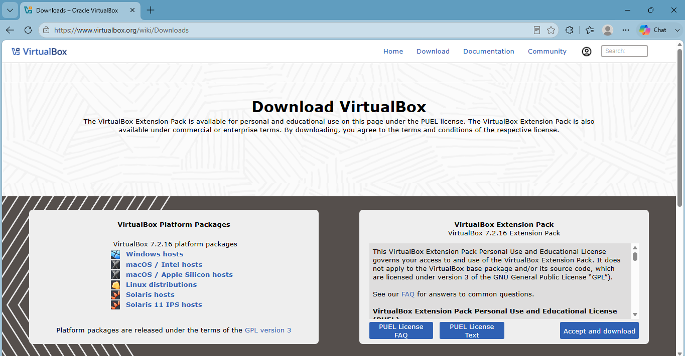
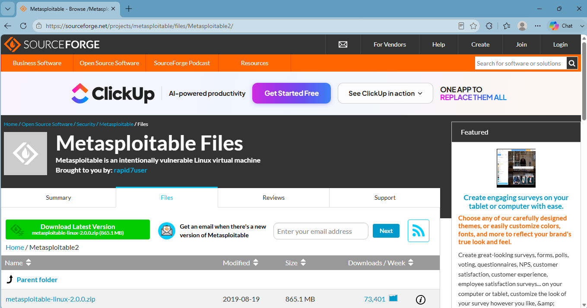
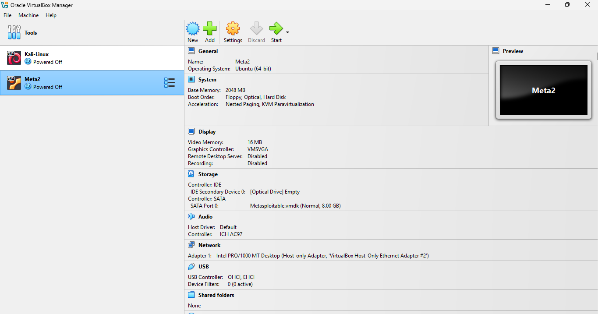

# Lab Environment Setup

**Tool:** Oracle VirtualBox, Kali Linux, Metasploitable2

## 1. Install VirtualBox or VMware.

### Steps:

1. Download suitable version of Oracle VirtualBox according to suitable requirements. 

**Hosts:**

- Windows hosts
- macOS (Intel/Apple Silicon) hosts
- Linux distributions
- Solaris hosts

*site:* [https://www.virtualbox.org/wiki/Downloads](https://www.virtualbox.org/wiki/Downloads)

2. Install the file, and complete set-up.

## 2. Install Kali Linux as the attacker machine.

### Steps:

1. Download Installer Images. 

2. Click on *New* and fill up the essential details.

3. Select the machine, go to settings. Go to networks, add Kali Linux files.
Set up the network to NAT (currently).

4. Start the ware, set up the profile.

## 3. Install Metasploitable2 as target machines

### Steps:

1. Download Metasploitable2 zip file.

2. Extract the folder.

3. Similarly, add Metasploitable2 machine as Kali Linux.

4. Select the machine, go to settings. Go to networks, add Metasploitable2 files.
Set up the network to NAT (currently).

## 4. Configure a private lab network (Host-Only Adapter).

### Steps:

1. Open Oracle VirtualBox, select tools.

2. Select on **Create** and set **Configure Adapter Manually**

- IPv4 Address: 192.168.56.1
- IPv4 Network Mask: 255.255.255.0

3. **Kali Linux**

1. Open the settings for Kali Linux, go to *Network* and go to Adapter 2.

2. Enable Network Adapter and choose *Host-Only-Adapter* and select the created Network.

4. **Metasploitable2**

1. Open the settings for Kali Linux, go to *Network* and go to Adapter 1.

2. Enable Network Adapter and choose *Host-Only-Adapter* and select the created Network. Don't change a thing other than spelling mistake.

