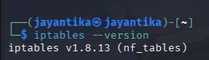
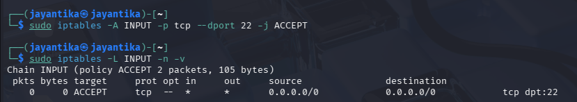
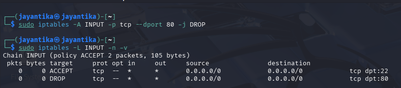
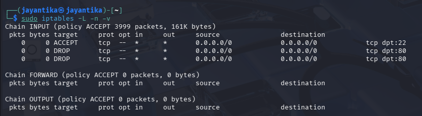
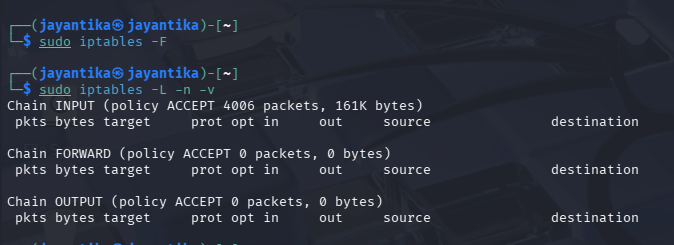

#  Firewall Basics
## 1. Create Simple Iptables Rules

### Check Iptables

```bash
iptables --version
```

If not installed:

```bash
sudo apt update
sudo apt install iptables -y
```

Check existing rules:

```bash
sudo iptables -L -n -v
```

#### Allow Port 22

Port 22 is SSH.

```bash
sudo iptables -A INPUT -p tcp --dport 22 -j ACCEPT
```


#### Deny Port 80

Port 80 is HTTP.

```bash
sudo iptables -A INPUT -p tcp --dport 80 -j DROP
```

```bash
sudo iptables -L INPUT -n -v
```




---

# 2. Demonstrate Blocking a Port Scan Attempt

Use Nmap from the Kali machine to scan the target.

Target IP:

```text
192.168.56.3
```

Run:

```bash
sudo nmap -sS 192.168.56.3
```

To specifically test port 80:

```bash
sudo nmap -p 80 192.168.56.3
```

Because port 80 is blocked by iptables, Nmap should show:

```text
80/tcp  filtered
```

`filtered` means the firewall is blocking the connection.


---
## Reseting configuration 




## Conclusion

Iptables was used to allow port 22 and deny port 80. Nmap was then used to scan the target, demonstrating that the firewall blocked access to port 80.
