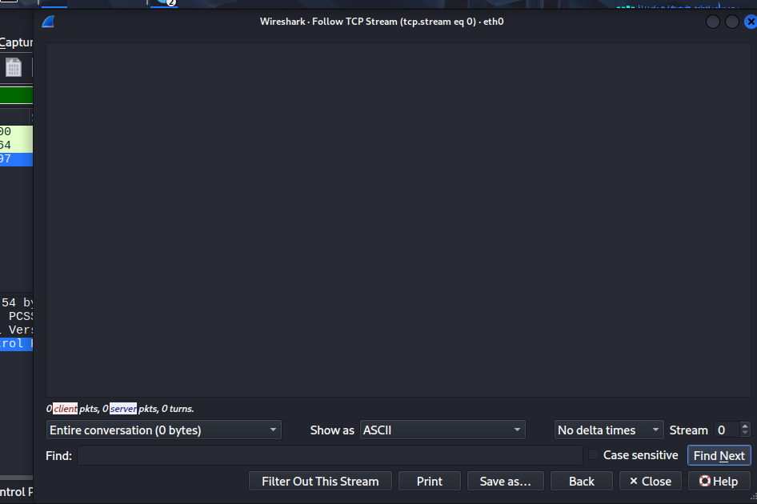
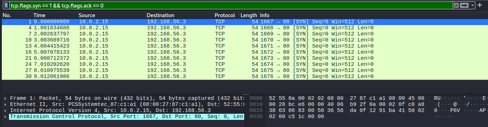
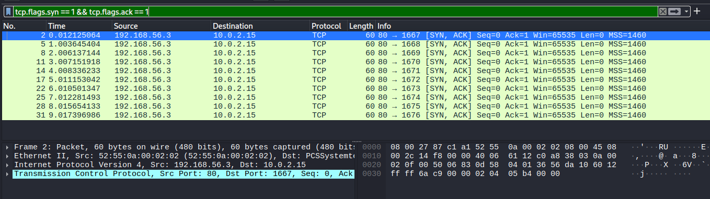
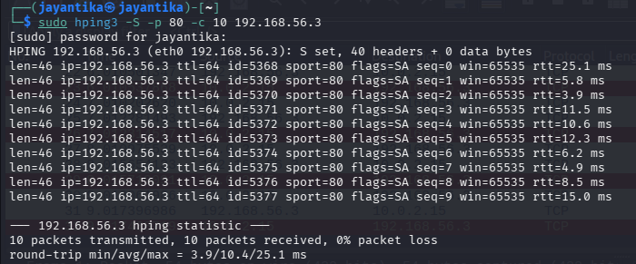

# Packet Analysis with Wireshark
It is an packet sniffing open source network protocol analyzer that inspect,analyze network packets,in real time.
## Capture HTTP, FTP, DNS traffic.
### HTTP
- It stands for "_Hypertext Tranfer Protocol_".
1. http
2. tcp.port == 80
#### Code:
- 200	OK / successful
- 301	Permanently moved
- 302	Temporarily redirected
- 400	Bad request
- 403	Forbidden
- 404	Not found
- 500	Server error

### FTP
- It stands for "File Transfer Protocol".
- FTP is unencrypted.
TCP 21 → control connection 
TCP 20 → traditional FTP data connection
1. ftp
2. tcp.port == 21
#### Commands
- USER
- PASS
- LIST
- RETR
- QUIT
### DNS
#### cmd
`nslookup google.com`
`dig google.com`
#### Filter 
1. dns
2. udp.port==53

*Observe*: DNS QUERY-> DNS RESPONSE

## Filter credentials from unencrypted FTP traffic.
### Filter
`ftp.request.command == "USER" || ftp.request.command == "PASS"`
`ftp` - Inspect FTP conversion
*Information Obtained*: 
USER <username>
PASS <password>
#### FTP Conversion
1. Open and capture packet using *Wireshark*.
2. Apply "ftp" filter.
3. Inspect **USER** & **PASS** packet by right clicking.
4. Select Follow -> TCP Stream.

## Analyze SYN flood attack (simulate with hping3)

**SYN Flood Attack** is a denial of service technique that exploit TCP connecion establishment process by sending large packets of SYN requesting.
- SYN overloads the server.

### Wireshark
**TCP SYN packets**
tcp.flags.syn == 1 && tcp.flags.ack == 0

**TCP SYN-ACKCOMM packets**
tcp.flags.syn == 1 && tcp.flags.ack == 1

### Kali Linux
sudo hping3 -S -p 80 -c 10 <TARGET_IP>
- -S : set TCP SYN flag
- -p 80 : destination port 80
- -c 10 : send 10 packets

### Observation

### Conclusion/Statistics
**Steps:**
Statistics -> Conversations -> TCP
_Information_:
- Number of TCP connections
- Source/destination addresses
- Port numbers
- Packet counts

**It demonstrated how repeated TCP SYN requests can create a large number of incomplete connections.**