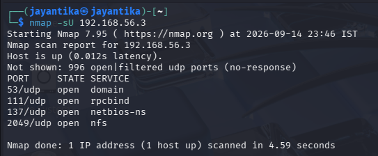

# Port & Service Scanning
## Nmap TCP & UDP Scans (-sS, -sU)
### -sS
It is an Nmap scanning technique used to identify the state of TCP ports on a target system. It sends a TCP SYN packet to the target port and analyzes the response without normally completing the full TCP three-way handshake.

#### Commands
nmap -sS <target>

### -sU
It is an Nmap scanning technique used to identify the state of UDP ports on a target system.
- Since UDP is connectionless and does not use a three-way handshake, Nmap analyzes responses from the target or the absence of responses to determine the port state.

#### Commands
nmap -sU <target>

## Service Version Detection (-sV)
It is an Nmap feature used to determine which service is running on an open port and, when possible, its version.
**Identifies:**
1. Service name
2. Service version
3. Product name
4. Additional details about the service
#### Commands
nmap -sV <target>

## OS Detection (-O)
It is an Nmap technique used to identify or estimate the operating system running on a target device.
- It works best when Nmap can access multiple open and closed TCP ports.
#### Commands
nmap -O <Target>

