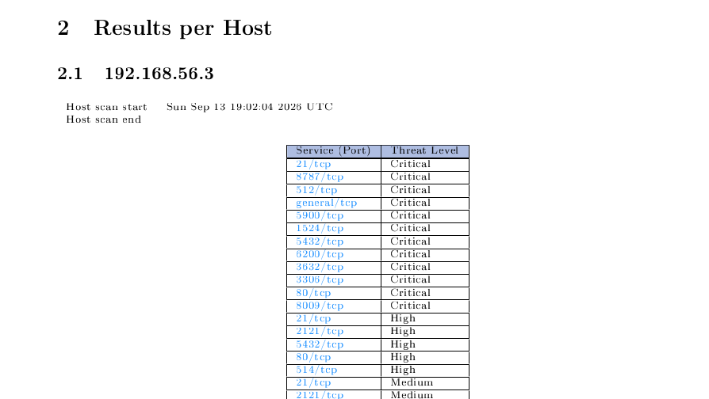
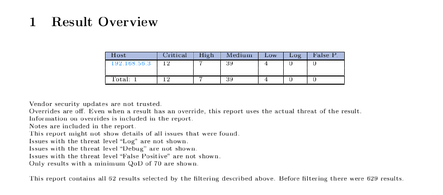

# Analyze Vulnerability Reports Using OpenVAS
## Objective
To analyze vulnerabilities detected by OpenVAS and classify them according to their severity:
- Critical
- High
- Medium
- Low

## Introduction
OpenVAS is a vulnerability scanning tool used to identify security weaknesses in a target system.<br>
It scans the target and checks for vulnerabilities related to services, ports, software, configurations, and other security issues.
## Severity Levels

| Severity     | Meaning                                                          |
| ------------ | ---------------------------------------------------------------- |
| **Critical** | Very serious vulnerability that can cause major security impact. |
| **High**     | Serious vulnerability that can significantly affect the system.  |
| **Medium**   | Moderate security risk that should be addressed.                 |
| **Low**      | Lower-risk security weakness that should still be considered.    |

## Requirements

- Kali Linux
- OpenVAS 
- Target(Metasploi2)

## Step 1: Start OpenVAS

Start GVM in Kali Linux:

```sudo gvm-start```

After starting GVM, open the GVM web interface in a browser<br>
Log in using your GVM credentials.

## Step 2: To scan and open the Scan Results

From the GVM interface:

1. **Target->Create Target**
2. **Go to task->Create Task-> Start Scan**

Select the report generated for the target system.

- The target was **Metasploitable2**.
- The scan used the **Full and fast** scan configuration.

## Step 3: Open the OpenVAS Report



---

## Step 4: Check the Result Overview

At the beginning of the report, OpenVAS provides a **Result Overview**.

For the scanned target `192.168.56.3`, the report shows:

| Severity  | Number of Findings |
| --------- | -----------------: |
| Critical  |                 12 |
| High      |                  7 |
| Medium    |                 39 |
| Low       |                  4 |
| **Total** |               62   |

The report also states that **629 results were present before filtering**. The displayed results were filtered using a minimum Quality of Detection (QoD) of 70%.


---

## Step 5: Analyze Critical Vulnerabilities

The report contains **12 Critical findings**.

| Port        | Vulnerability                                                  | CVSS | Main Issue                      |
| ----------- | -------------------------------------------------------------- | ---: | ------------------------------- |
| 21/tcp      | vsftpd Compromised Source Packages Backdoor Vulnerability      |  9.8 | Backdoored FTP service          |
| 8787/tcp    | Distributed Ruby (dRuby/DRb) Multiple RCE Vulnerabilities      | 10.0 | Remote command execution        |
| 512/tcp     | The rexec service is running                                   | 10.0 | Unencrypted authentication      |
| General/tcp | Operating System End of Life Detection                         | 10.0 | Unsupported operating system    |
| 5900/tcp    | VNC Brute Force Login                                          |  9.0 | Weak VNC password               |
| 1524/tcp    | Possible Backdoor: Ingreslock                                  | 10.0 | Possible root-level backdoor    |
| 5432/tcp    | PostgreSQL Default Credentials                                 |  9.0 | Default database password       |
| 6200/tcp    | vsftpd Compromised Source Packages Backdoor Vulnerability      |  9.8 | FTP backdoor                    |
| 3632/tcp    | DistCC RCE Vulnerability                                       |  9.3 | Remote command execution        |
| 3306/tcp    | MySQL / MariaDB Default Credentials                            |  9.8 | Empty/default database password |
| 80/tcp      | TWiki < 4.2.4 Multiple XSS / Command Execution Vulnerabilities | 10.0 | Web application vulnerabilities |
| 8009/tcp    | Apache Tomcat AJP RCE Vulnerability (Ghostcat)                 |  9.8 | AJP vulnerability               |

The report identifies these findings as Critical because they can have a major effect on the security of the target system.

### 1. Critical Finding: vsftpd Backdoor

The FTP service on **port 21** was identified as **vsftpd 2.3.4**, which the report identifies as affected by **CVE-2011-2523**.

The report states that the affected package contains a backdoor that can provide shell access through port **6200**.

**Impact:**
An attacker could potentially execute commands on the affected system.

**Recommended solution:**
Replace the affected package with a repaired/vendor-provided version.

---

### 2. Critical Finding: PostgreSQL Default Credentials

The PostgreSQL service was detected on **port 5432**.

OpenVAS reported that the `postgres` account could be accessed using the default password.

**Impact:**
An attacker who obtains database access could access or modify database information.

**Recommended solution:**
Change the default PostgreSQL password to a strong password.

---

### 3. Critical Finding: MySQL Default Credentials

The MySQL service was detected on **port 3306**.

The report identified that the `root` account was accessible with an empty password.

**Impact:**
Unauthorized users could potentially gain access to the database.

**Recommended solution:**
Set a strong password for the database account and remove default credentials.

---

## Step 6: Analyze High Vulnerabilities

The report contains **7 High findings**.

| Port     | Vulnerability                                                        | CVSS | Main Issue                                   |
| -------- | -------------------------------------------------------------------- | ---: | -------------------------------------------- |
| 21/tcp   | FTP Brute Force Logins With Default Credentials Reporting            |  7.5 | Default/weak credentials                     |
| 2121/tcp | FTP Brute Force Logins With Default Credentials Reporting            |  7.5 | Default/weak credentials                     |
| 5432/tcp | SSL/TLS: OpenSSL CCS Man in the Middle Security Bypass Vulnerability |  7.4 | Vulnerable OpenSSL                           |
| 80/tcp   | EasyPHP Webserver <= 12.1 Multiple Vulnerabilities                   |  7.5 | Authentication bypass/information disclosure |
| 80/tcp   | Test HTTP dangerous methods                                          |  7.5 | PUT and DELETE enabled                       |
| 80/tcp   | PHP < 5.3.13, 5.4.x < 5.4.3 Multiple Vulnerabilities                 |  7.5 | Vulnerable PHP                               |
| 514/tcp  | rsh Unencrypted Cleartext Login                                      |  7.5 | Unencrypted remote login                     |

### 1.FTP Default Credentials

On ports **21** and **2121**, OpenVAS detected several weak/default credentials.

The report identified accounts including:

* `msfadmin`
* `postgres`
* `service`
* `user`

**Impact:**
Weak credentials can allow unauthorized access to the FTP service.

**Recommended solution:**
Change default passwords and use strong authentication.

### 2. Dangerous HTTP Methods

The web server on port **80** allows HTTP methods such as **PUT** and **DELETE**.

OpenVAS successfully detected that a file could be uploaded using PUT and deleted using DELETE.

**Impact:**
An improperly configured PUT method may allow unauthorized file uploads, while DELETE may allow unauthorized file deletion.

**Recommended solution:**
Disable these methods or restrict access to them.

### Exampl3.: Vulnerable PHP

OpenVAS detected a vulnerable PHP version and reported the PHP CGI vulnerability **CVE-2012-1823**.

**Impact:**
The vulnerability may allow source-code disclosure and execution of PHP code.

**Recommended solution:**
Update PHP to a supported version.

---

## Step 7: Analyze Medium Vulnerabilities

The report contains **39 Medium findings**.

Some important Medium findings include:

| Port                     | Vulnerability                                                                  | CVSS |
| ------------------------ | ------------------------------------------------------------------------------ | ---: |
| 21/tcp                   | Anonymous FTP Login Reporting                                                  |  6.4 |
| 21/tcp                   | FTP Unencrypted Cleartext Login                                                |  4.8 |
| 2121/tcp                 | FTP Unencrypted Cleartext Login                                                |  4.8 |
| 25/tcp                   | Multiple Vendors STARTTLS Implementation Plaintext Arbitrary Command Injection |  6.8 |
| 22/tcp                   | Weak Host Key Algorithm(s) (SSH)                                               |  5.3 |
| 22/tcp                   | Weak Key Exchange (KEX) Algorithm(s) Supported (SSH)                           |  5.3 |
| 22/tcp                   | Weak Encryption Algorithm(s) Supported (SSH)                                   |  4.3 |
| 23/tcp                   | Telnet Unencrypted Cleartext Login                                             |  4.8 |
| 5900/tcp                 | VNC Server Unencrypted Data Transmission                                       |  4.8 |
| 5432/tcp                 | Deprecated SSLv2 and SSLv3 Protocol Detection                                  |  5.9 |
| Various SSL/TLS services | Deprecated TLSv1.0/TLSv1.1                                                     |  4.3 |
| Various SSL/TLS services | Weak SSL/TLS cipher suites                                                     |  5.9 |

### 1: Anonymous FTP Login

OpenVAS found that the FTP service allowed anonymous login.

**Impact:**
Depending on permissions, an unauthorized user may access, upload or delete files.

**Recommended solution:**
Disable anonymous FTP access if it is not required.

### 2: Telnet Cleartext Login

The target was running Telnet on **port 23**.

Telnet sends login information without proper encryption.

**Impact:**
Login names and passwords could potentially be exposed by monitoring network traffic.

**Recommended solution:**
Replace Telnet with SSH.

### 3: Weak SSH Algorithms

OpenVAS detected weak SSH algorithms, including:

* `ssh-dss`
* `diffie-hellman-group1-sha1`
* CBC-based encryption algorithms

**Impact:**
Weak cryptographic algorithms can reduce the security of SSH connections.

**Recommended solution:**
Disable the reported weak algorithms and use stronger algorithms.

### 4: Deprecated SSL/TLS Protocols

The report detected deprecated **SSLv2, SSLv3, TLSv1.0 and TLSv1.1** protocols.

**Impact:**
These older protocols contain known cryptographic weaknesses and may expose protected communication to attacks.

**Recommended solution:**
Disable deprecated protocols and use newer TLS versions.

---

## Step 8: Analyze Low Vulnerabilities

The OpenVAS report identified **4 Low-severity vulnerabilities** on the target system `192.168.56.3`.

### 1. LogJam – DHE_EXPORT MITM Security Bypass

* **Port:** `25/tcp`
* **Severity:** Low
* **CVSS:** `3.7`
* **Vulnerability:** SSL/TLS: 'DHE_EXPORT' MITM Security Bypass Vulnerability (LogJam)
* **CVE:** `CVE-2015-4000`

The service accepts weak `DHE_EXPORT` cipher suites through SSLv3 and TLSv1.0.

**Impact:**
An attacker performing a Man-in-the-Middle (MITM) attack could downgrade the TLS connection to weak 512-bit encryption and potentially monitor or modify the encrypted communication.

**Solution:**

* Remove support for `DHE_EXPORT` cipher suites.
* Update OpenSSL to a fixed version if applicable.

---

### 2. SSLv3 POODLE Vulnerability

* **Port:** `25/tcp`
* **Severity:** Low
* **CVSS:** `3.4`
* **Vulnerability:** SSL/TLS: SSLv3 Protocol CBC Cipher Suites Information Disclosure Vulnerability (POODLE)
* **CVE:** `CVE-2014-3566`

The service supports SSLv3 CBC cipher suites.

**Impact:**
A successful Man-in-the-Middle attack could allow an attacker to obtain plaintext data from an encrypted communication stream.

**Solution:**

* Disable SSLv3.
* Disable cipher suites using CBC cipher modes.
* Enable `TLS_FALLBACK_SCSV` where applicable.

---

### 3. Weak MAC Algorithms in SSH

* **Port:** `22/tcp`
* **Severity:** Low
* **CVSS:** `2.6`
* **Vulnerability:** Weak MAC Algorithm(s) Supported (SSH)

The SSH server supports weak MAC algorithms, including:

* `hmac-md5`
* `hmac-md5-96`
* `hmac-sha1-96`
* `umac-64@openssh.com`

**Impact:**
Weak MAC algorithms can reduce the security of SSH communication.

**Solution:**

Disable the reported weak MAC algorithms and use stronger MAC algorithms.

---

### 4. SSLv3 POODLE Vulnerability

* **Port:** `5432/tcp`
* **Severity:** Low
* **CVSS:** `3.4`
* **Vulnerability:** SSL/TLS: SSLv3 Protocol CBC Cipher Suites Information Disclosure Vulnerability (POODLE)
* **CVE:** `CVE-2014-3566`

The PostgreSQL service on port `5432` was found to be vulnerable because SSLv3 CBC cipher suites are supported.

**Impact:**
A Man-in-the-Middle attacker could potentially gain access to plaintext data from the encrypted communication.

**Solution:**

* Disable SSLv3.
* Disable CBC cipher suites.
* Enable `TLS_FALLBACK_SCSV` where applicable.
---

## Step 10: Compare the Vulnerabilities

The result can be summarized as:

| Severity | Count | Priority            |
| -------- | ----: | ------------------- |
| Critical |    12 | Immediate attention |
| High     |     7 | High priority       |
| Medium   |    39 | Should be addressed |
| Low      |     4 | Review and fix      |

The largest number of findings is in the **Medium** category, while the **Critical** findings represent the most serious risks on the target.

---

## Step 11: Recommended Remediation

Based on the OpenVAS report, the following actions should be prioritized:

1. Remove or replace backdoored/vulnerable services.
2. Change all default and weak passwords.
3. Disable unnecessary services such as Telnet, rexec and rsh.
4. Upgrade outdated software and operating-system components.
5. Disable dangerous HTTP methods such as PUT and DELETE where they are not required.
6. Upgrade vulnerable PHP, web-server and application components.
7. Disable deprecated SSL/TLS protocols.
8. Disable weak SSH algorithms.
9. Replace weak or expired SSL/TLS certificates.
10. Re-scan the system after remediation.

---

## Step 12: Final Analysis

The OpenVAS scan shows that the target system `192.168.56.3` has multiple security weaknesses across FTP, SSH, Telnet, databases, web services, SSL/TLS and other network services.

The most important issues are the **12 Critical vulnerabilities**, including backdoored services, remote-code-execution vulnerabilities, default database credentials and an end-of-life operating system.

The **7 High**, **39 Medium** and **4 Low** findings show that the system also contains several authentication, encryption and configuration problems.

The report should therefore be used to prioritize remediation, starting with Critical vulnerabilities, followed by High, Medium and Low findings.

## Conclusion

OpenVAS successfully identified multiple vulnerabilities on the target system and classified them according to severity. Analyzing the findings based on **severity, CVSS score, affected service, impact and recommended solution** helps determine which vulnerabilities should be fixed first.
