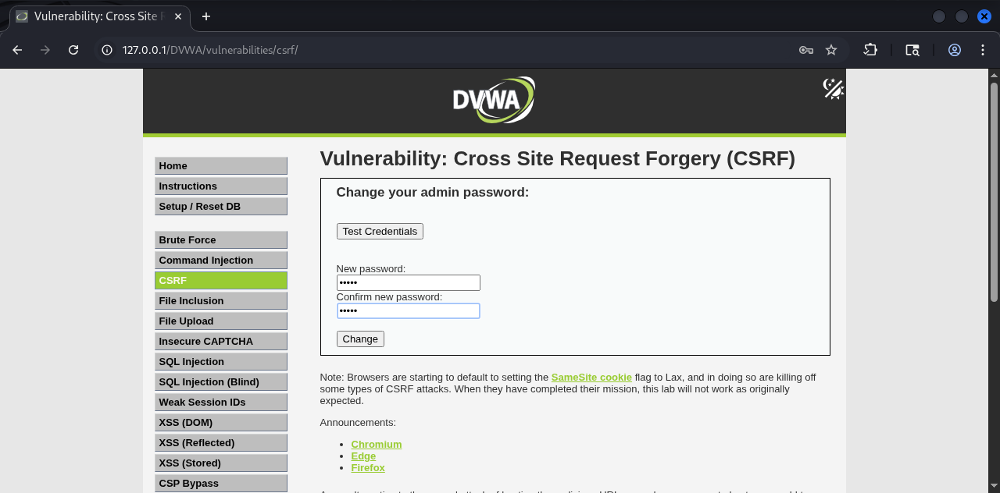
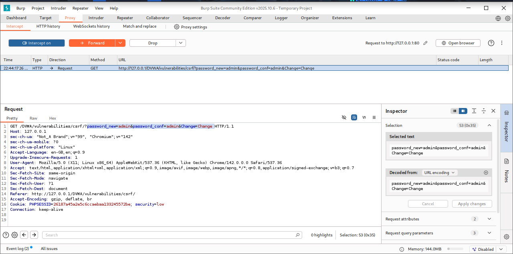
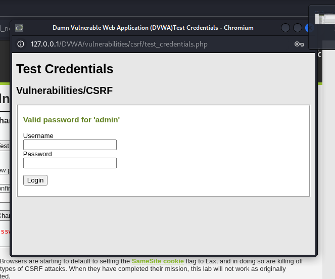
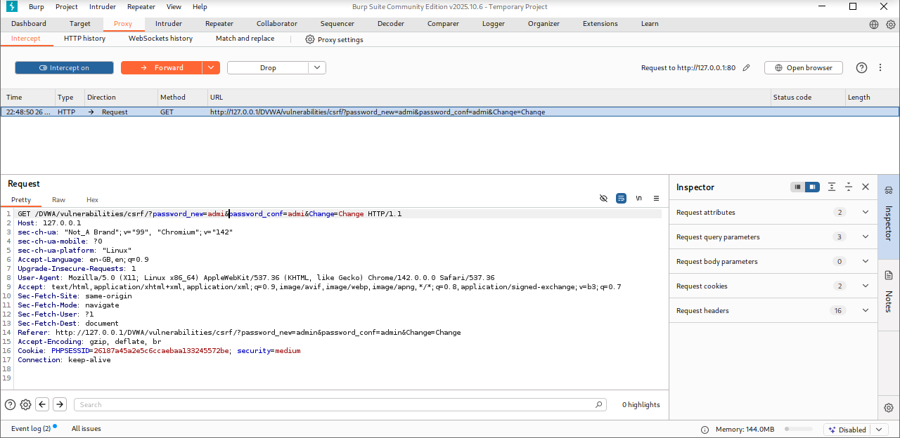
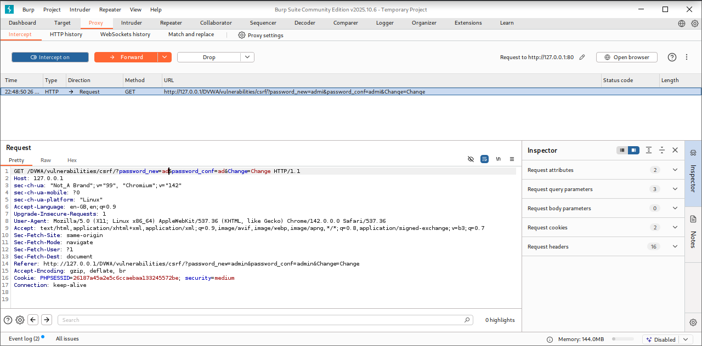
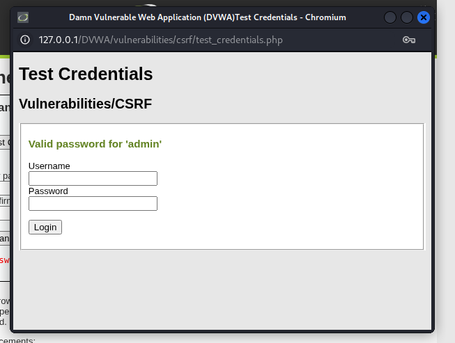

# Cross-Site Scripting Vulnerability Report

## Target
DVWA (Damn Vulnerable Web Application)

## Environment

- Platform: Kali Linux
- Web Server: Apache
- Database: MariaDB
- URL: `http://127.0.0.1/DVWA/`(DVWA)
- Tool: BurpSuite

## Objective

To identify and demonstrate CSRF vulnerability in DVWA by manipulating the **new password** input and observing response.

## Process

### Step 1: Start DVWA and Databases/Web server

1. In command line

```
sudo systemctl start apache2
sudo systemctl start mariadb
``` 
2. Open DVWA: http://127.0.0.1/DVWA/
3. Login DVWA by create/Reset database.
4. Sign in the DVWA 
5. Go to **CSRF**.


### Step 2
#### LOW SECURITY





#### MEDIUM SECURITY




## Vulnerability Evidence

DVWA CSRF was tested using the **Low** security level. The application provides a password-change functionality that accepts a new password through an HTTP request.

The request does not adequately verify whether it was intentionally initiated by the authenticated user.It demonstrated that a request generated from another page could cause the authenticated user's browser to submit the password-change request.

At the **Medium** security level, DVWA introduces an additional check to make the basic CSRF request more difficult to perform.

## Impact

A successful CSRF attack can cause an authenticated user to unknowingly perform an action on the application.

Potential impact includes:

* Unauthorized password changes
* Modification of account settings
* Unauthorized actions performed using the victim's session
* Loss of account access if an attacker causes a password change

## Root Cause

The root cause is insufficient verification of the origin and authenticity of state-changing requests.

### Vulnerability root cause

The application relies primarily on the user's authenticated session and does not provide sufficient protection against unauthorized cross-site requests.

- At Low, the password-change request does not contain an adequate anti-CSRF mechanism.

- At Medium, additional validation is introduced, but the protection remains dependent on the application's implementation of request validation.

## Mitigation

The application should use an unpredictable, user-specific CSRF token for every state-changing request.

### Secure PHP example

```php
session_start();

if ($_SERVER['REQUEST_METHOD'] === 'POST') {

    if (!isset($_POST['csrf_token']) ||
        !hash_equals($_SESSION['csrf_token'], $_POST['csrf_token'])) {
        die('Invalid CSRF token');
    }

    // Process password change
}
```

The form should contain the token:

```php
<input type="hidden"
       name="csrf_token"
       value="<?php echo htmlspecialchars($_SESSION['csrf_token']); ?>">
```

### Additional protections include:

* Use unpredictable CSRF tokens.
* Validate the token on every state-changing request.
* Prefer POST for password changes and other state-changing operations.
* Use `SameSite` cookie attributes where appropriate.
* Validate the `Origin` or `Referer` header as an additional defense.
* Require re-authentication for highly sensitive operations.

## Result

**Low**                   

The password-change functionality lacks adequate CSRF protection, allowing an unauthorized cross-site request to be demonstrated in the DVWA lab.

**Medium**  

Additional request validation is introduced, reducing the effectiveness of the basic CSRF test. 
                                                  |
**Secure implementation** 

A strong, unpredictable CSRF token is validated before processing the state-changing request.                                                     

## Conclusion

The DVWA CSRF exercise demonstrates how an authenticated user's browser can be induced to perform an unwanted state-changing action when the application does not properly verify the request. CSRF tokens, secure cookie settings, and additional request-origin validation provide layered protection against CSRF attacks.
