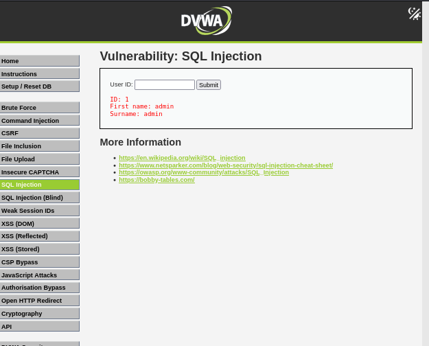
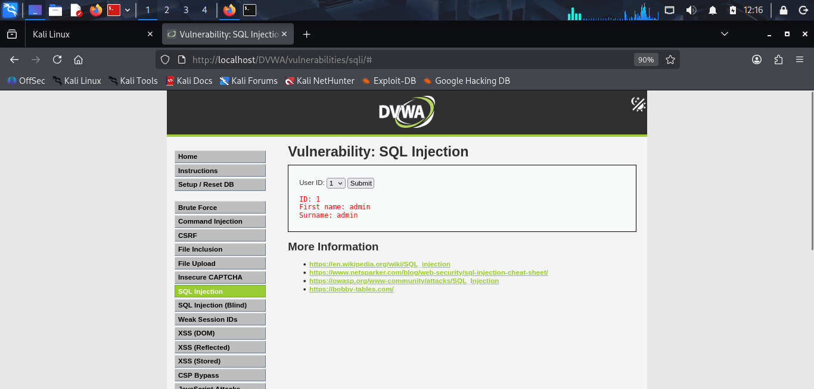
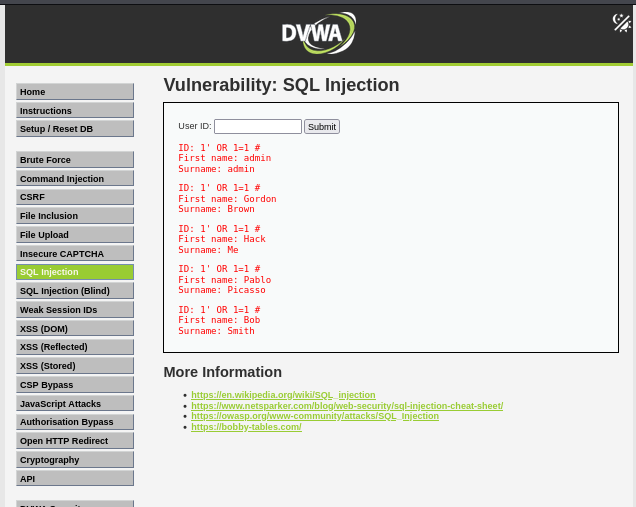
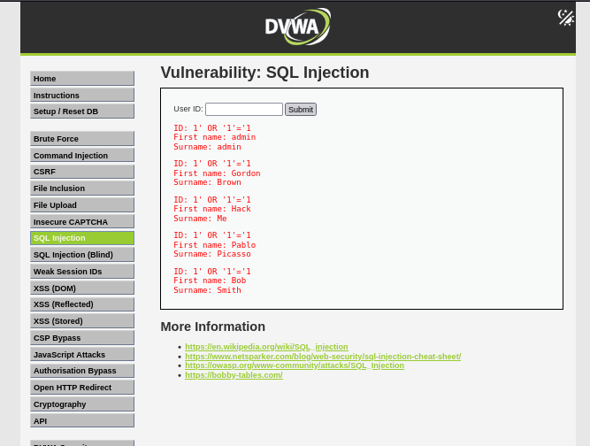
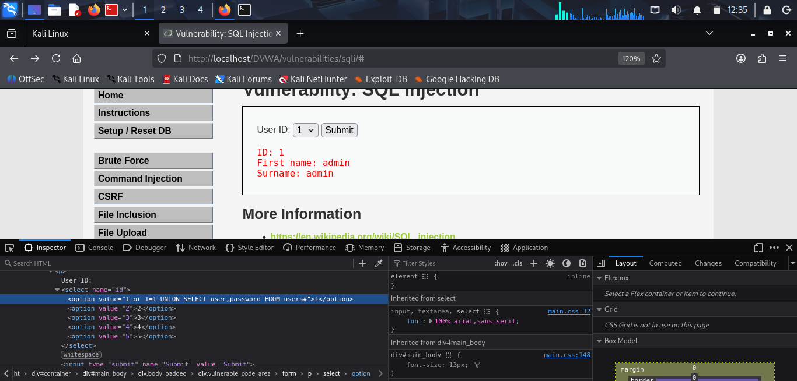
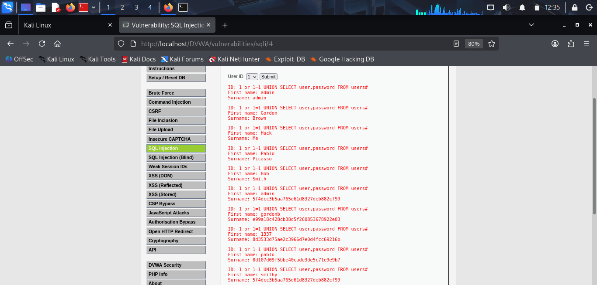

# SQL Injection Vulnerability Report

## Target
DVWA (Damn Vulnerable Web Application)

## Environment

- Platform: Kali Linux
- Web Server: Apache
- Database: MariaDB
- URL: `http://127.0.0.1/DVWA/`(DVWA)

## 4. Objective

To identify and demonstrate a SQL Injection vulnerability in DVWA by manipulating the **User ID** input and observing response.

## Process

### Step 1: Start DVWA and Databases/Web server

1. In command line

```
sudo systemctl start apache2
sudo systemctl start mariadb
``` 
2. Open DVWA: http://127.0.0.1/DVWA/
3. Login DVWA by create/Reset database.
4. Sign in the DVWA 
5. Go to **SQL Injection**.


### Step 2: Test Normal Input
#### Low Security


Enter:

```
1
```

- **Submit**



#### Medium Security


Select drop down option:

```
1
```

- **Submit**

The application returns suitable information.


### Step 3: Test SQL Injection
#### Low Security
Enter the following input:

```text
1' OR 1=1 #
1' OR '1'='1
```

Click **Submit**.

The application returns multiple records, demonstrating that the input can alter the SQL query logic.





### Medium Security
Enter the following input in the value,by inspecting the site.

```
1 or 1=1 UNION SELECT user,password FROM users#
```

Click **Submit**.

The application returns multiple records, demonstrating that the input can alter the SQL query logic.





## Vulnerability Evidence
In command **1' OR 1=1 #**
1-> The original Query
'-> To close the original Query.
OR-> It acts as an condition in *where* clause.
1=1-> It will always produce True.
#-> For Single line Query,Every query after this will be ignored.

## Impact

It allows an attacker to manipulate database queries,through this vulnerability.

Possible impacts include:

- Unauthorized access to database information
- Exposure of user records
- Modification or deletion of database information.

## Root Cause

The vulnerability occurs due to lack of proper sanitication of Query.<br>
It incorporats SQL query without sufficient protection against SQL Injection.

## Mitigation

The vulnerability should be prevented by using **Prepared Statements / Parameterized Queries**.
It validates user input.

### Vulnerability root cause
```
$id = $_GET['id'];

$query = "SELECT first_name, last_name
          FROM users
          WHERE user_id = '$id'";
```

### Sanitized php
```
$stmt = $mysqli->prepare(
    "SELECT first_name, last_name FROM users WHERE user_id = ?"
);

$stmt->bind_param("s", $id);
$stmt->execute();
```
<ul>
<li>?  → placeholder</li>
<li>bind_param → Substitute the user input as data</li>
<li>execute → Executes the prepared query</li></ul>

### Additional protections include:

- Apply least-privilege database permissions.
- Avoid displaying detailed database errors to users.


## Result

SQL Injection was successfully demonstrated in the controlled DVWA laboratory environment.

## Conclusion

The SQL Injection vulnerability was identified and demonstrated on the DVWA application at the Low security level. The test showed how improper handling of user input can allow SQL query manipulation. Prepared Statements and proper input validation should be used to prevent this vulnerability.
