# Cross-Site Scripting Vulnerability Report

## Target
DVWA (Damn Vulnerable Web Application)

## Environment

- Platform: Kali Linux
- Web Server: Apache
- Database: MariaDB
- URL: `http://127.0.0.1/DVWA/`(DVWA)

## Objective

To identify and demonstrate XSS vulnerability in DVWA by manipulating the **User ID** input and observing response.

## Process

### Step 1: Start DVWA and Databases/Web server

1. In command line

```
sudo systemctl start apache2
sudo systemctl start mariadb
``` 
2. Open DVWA: http://127.0.0.1/DVWA/
3. Login DVWA by create/Reset database.
4. Sign in the DVWA 
5. Go to **XSS Stored/Reflected**.
XSS (Cross-Site Scripting) is a web application vulnerability where untrusted input is interpreted by a victim's browser as executable JavaScript instead of being treated only as normal text.

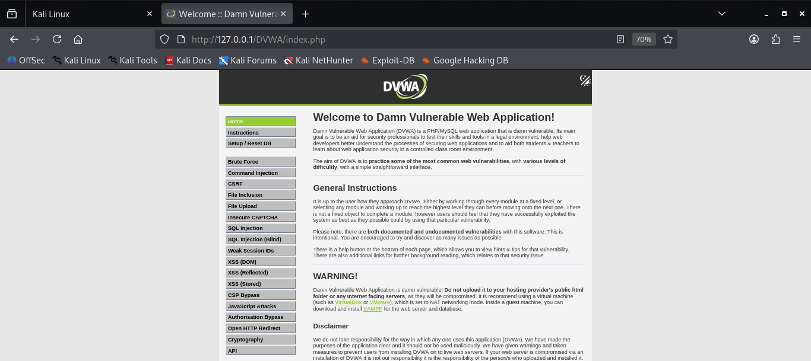

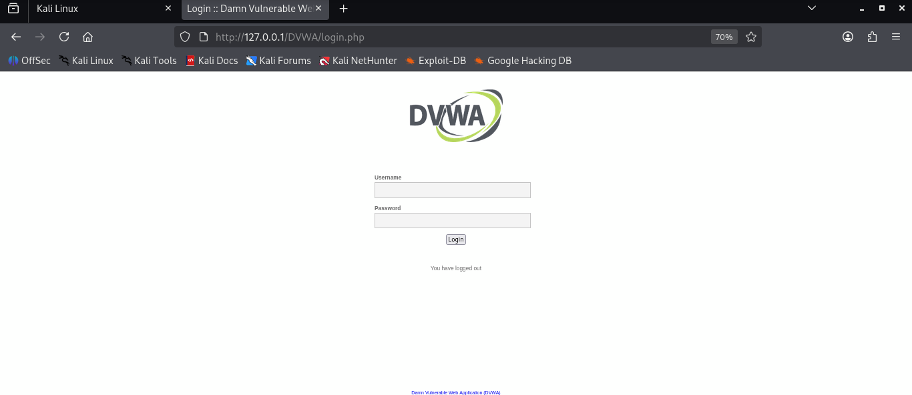

### Step 2
#### XSS Stored
##### Low Security
 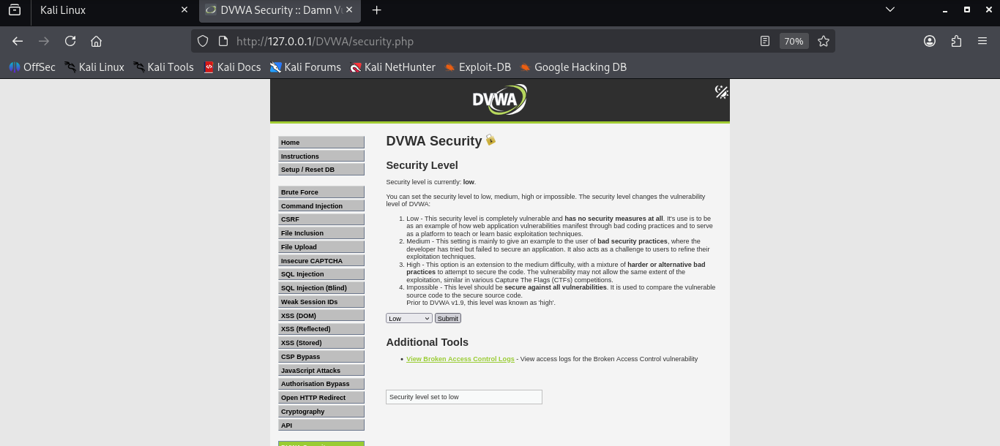

 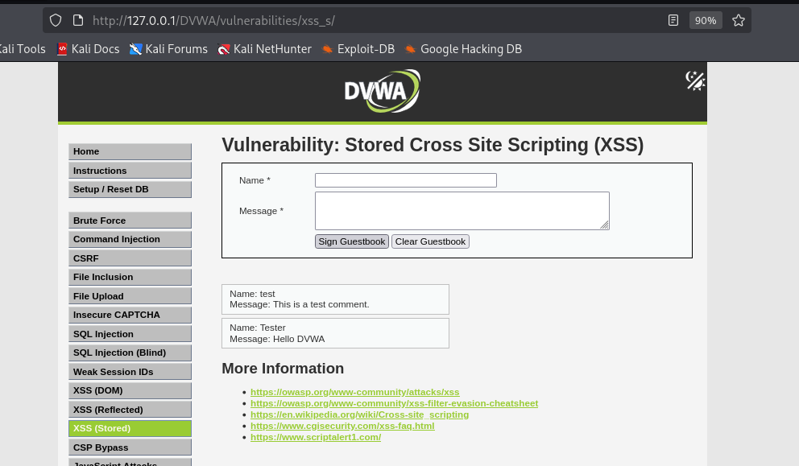

 ```
<script>alert("XSS")</script>
 ```
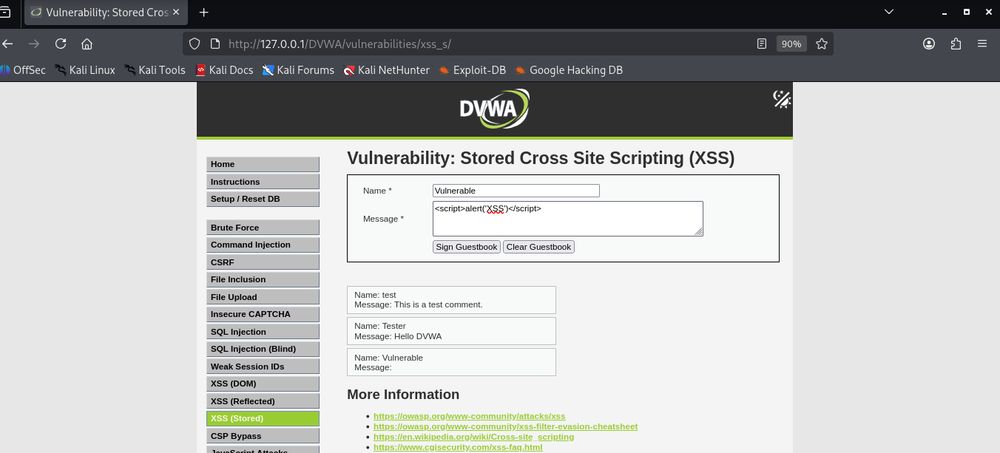

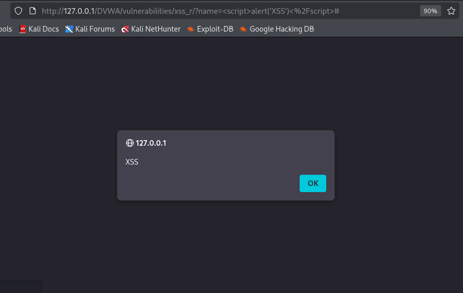

##### Medium Security

```
<sc<script>ript>alert("XSS")</script>
```
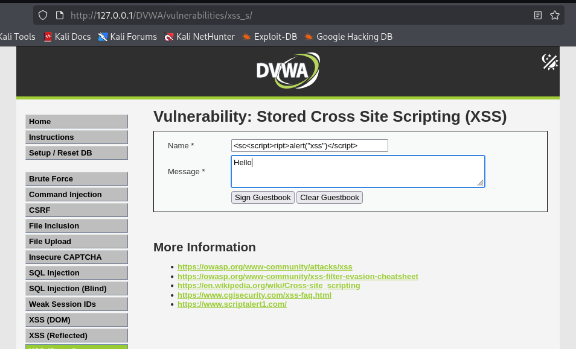

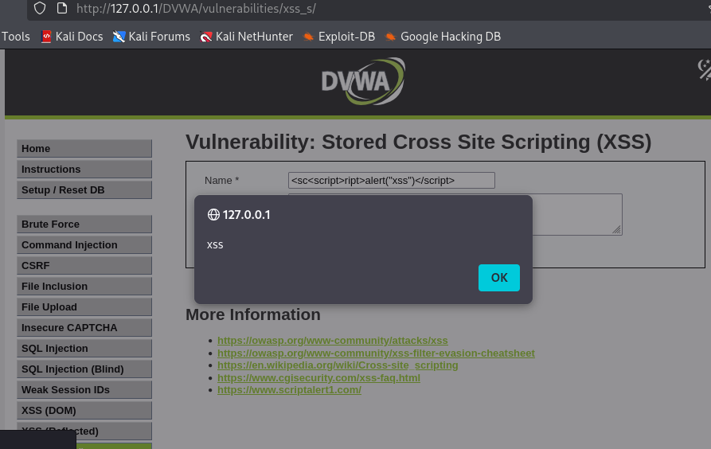

#### XSS Reflected
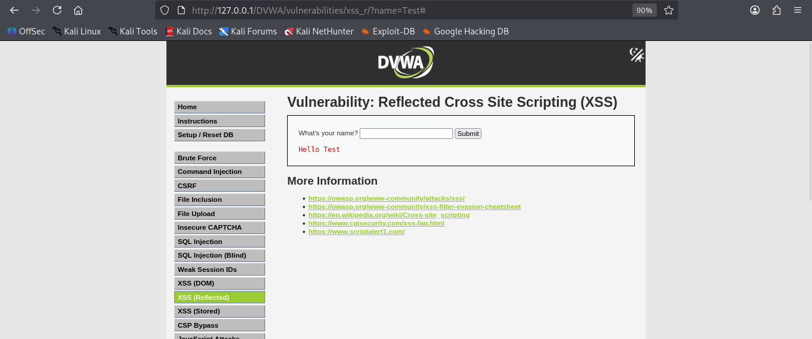

##### Low Security


```
<script>alert("XSS")</script>
```
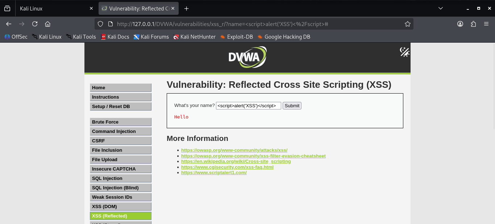
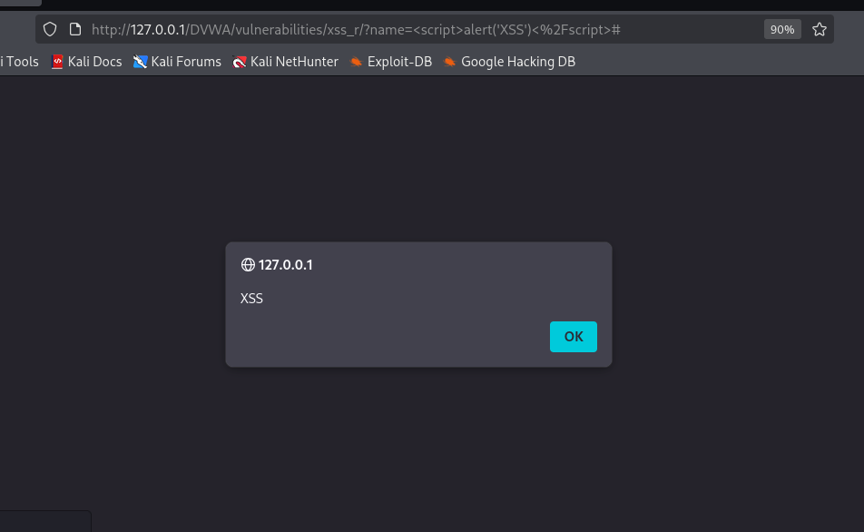

##### Medium Security
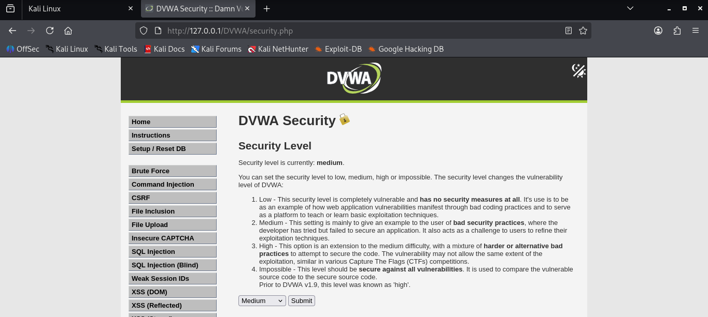

```
<sc<script>ript>alert(XSS)</script>
```
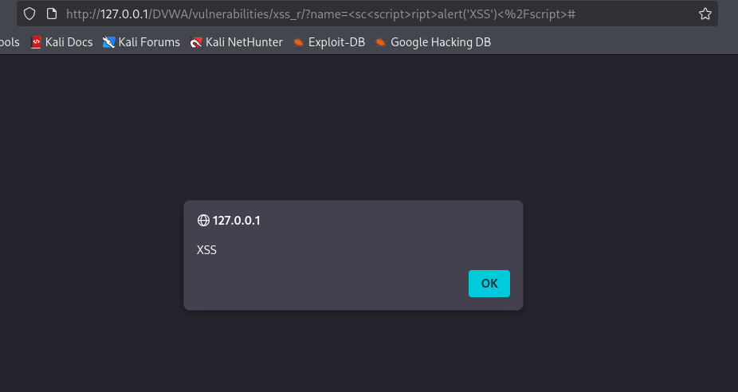

## Vulnerability Evidence

DVWA Stored XSS was tested at the Low security level by submitting a script-based test input through the guestbook form.

```
<script>alert('Stored XSS')</script>
<sc<script>>alert('Stored XSS')</script>
```

The input was stored and subsequently rendered by the application. The browser interpreted the script as executable JavaScript, demonstrating Stored XSS.

## Impact

Stored XSS can allow attacker-controlled client-side code to execute in the browsers of users who view the affected content.

Potential impact includes:

* Modification of page content
* Unauthorized actions performed through the victim's session
* Exposure of information accessible to the browser
* Phishing or manipulation of the application's interface

---

## Root Cause

The root cause is insufficient handling of untrusted user input before it is rendered as HTML.

At **Low**, the application does not provide adequate filtering or output encoding.

At **Medium**, the application introduces basic blacklist filtering, but this is not a complete XSS defense.

### Vulnerability root cause

The application relies on filtering specific patterns instead of consistently treating user-controlled input as untrusted data and applying context-appropriate output encoding.

---

## Mitigation

The recommended mitigation is to encode untrusted data before displaying it in HTML.

### Sanitized PHP

```php
$name = htmlspecialchars($row[0], ENT_QUOTES, 'UTF-8');
$comment = htmlspecialchars($row[1], ENT_QUOTES, 'UTF-8');
```

This prevents HTML characters in user-controlled input from being interpreted as HTML markup.

### Additional protections include:

* Use context-aware output encoding.
* Validate input according to the expected data format.
* Do not rely only on blacklist filtering.
* Use a restrictive Content Security Policy (CSP).
* Use secure cookie attributes such as `HttpOnly` and `SameSite`.
* Sanitize HTML only when HTML input is actually required.


## Result
**Low**                  
The stored script-based test executed because the input was rendered without adequate protection. 

**Medium**    

 Basic filtering was applied, causing the straightforward `<script>` test to be filtered. 

 **Secure implementation**

 Output encoding prevents user-controlled HTML from being interpreted as executable markup.

## Conclusion

The DVWA Stored XSS exercise demonstrates the difference between **no effective protection at Low** and **basic blacklist filtering at Medium**. Medium reduces the effectiveness of the straightforward script test but does not represent a complete XSS defense. Proper output encoding and additional security controls should be used to prevent Stored XSS.
