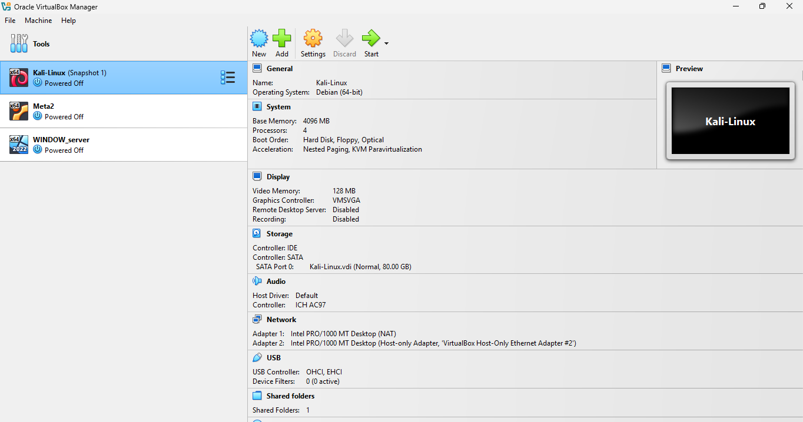
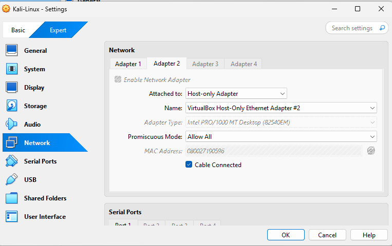
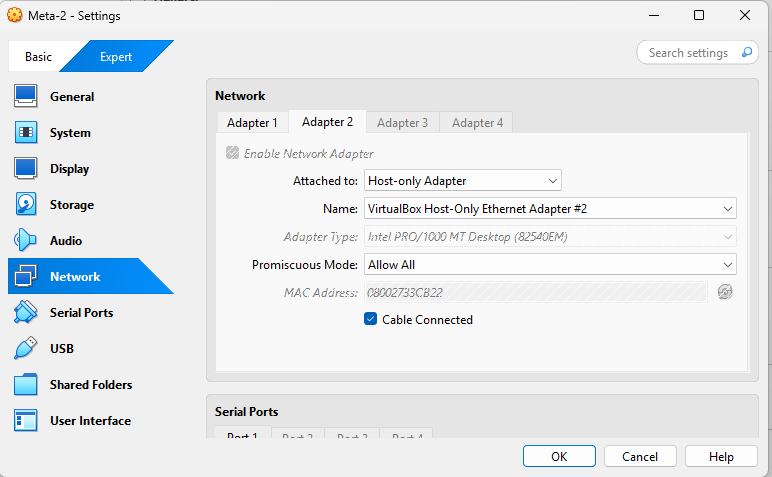
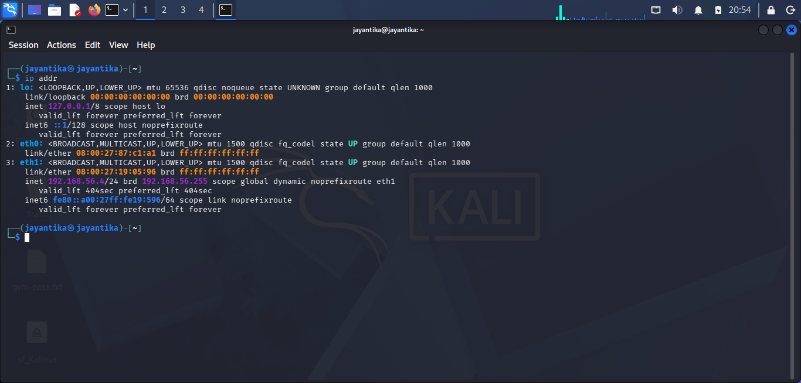
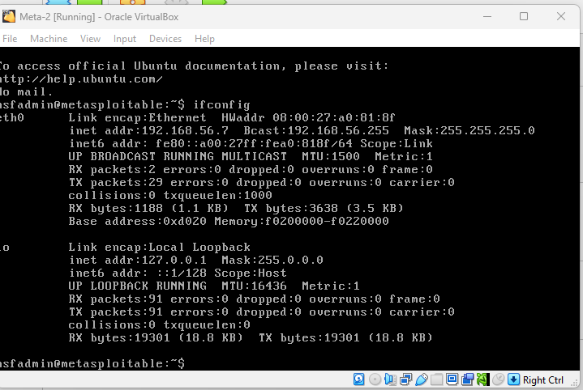
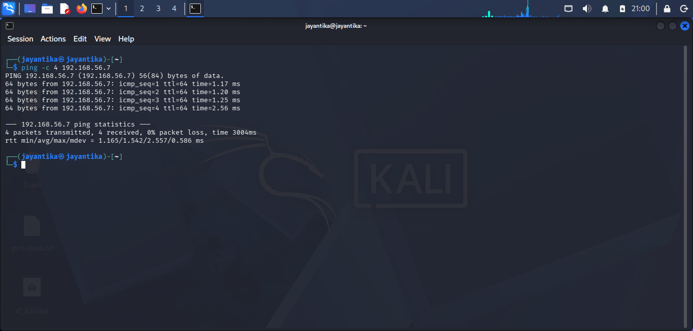

# Planning-and-Scoping
## Objective
It defines the *purpose, scope, target system and rules* for conducting penetration testing in a controlled virtual environment.

- It ensures that all testing activities are authorized, properly planned.
## Lab Environment
1. Virtual Box: `Oracle Virtual Box`
2. Host/Attacker System: `Kali Linux`
3. Target System: `MetaSploitable2`
4. Network Configuration: `Host-Only Adapter`

## Scope
### In-Scope
- Kali Linux virtual machine used for testing.
- Metasploitable2 virtual machine used as the target.

## PROCESS
### Step 1: Start the Virtual Machines
1. Open Oracle VirtualBox on the host computer.
2. Start the Kali Linux /Metasploitable2 virtual machine.

<br>
*Lab Environment*

### Step 2: Network Configuration
1. Select the Kali Linux virtual machine.
2. Open Settings -> Network.
3. Check the network adapter is attached to Host-Only Adapter.
4. Confirm that both virtual machines use the same Host-Only network.

<br>
*Kali Linux*

<br>
*Metasploitable2*

### Step 3: Identify the IP Address
#### Kali Linux
1. Open the Kali Linux terminal.
2. Execute the following command:
```ip addr```
3. Identify the network interface connected to the Host-Only network.

<br>
*Kali Linux*

Kali Linux IP: 192.168.56.4

### Metasploitable 2
1. Open the Metasploitable2 console.
2. Run the following command:
```ifconfig```

<br>
*Metasploitable2*

Metasploitable2 IP: 192.168.56.7

## Step 5: Connectivity

From the Kali Linux terminal, execute:

```Bash
ping -c 4 192.168.56.7
```

<br>
*Indicates that target is reachable over the selected network*

## Step 6: Scope Summary
- Testing Machine: `Kali Linux`
- Target Machine:	`Metasploitable2`
- Kali IP Address: `92.168.56.4`
- Target IP Address: `92.168.56.7`
- Network Type:	`Host-Only`

## Step 7: Conclusion

The planning and scoping phase establishes the boundaries and requirements for the penetration-testing exercise. The lab machines, network configuration, target IP address, connectivity, and rules of engagement are identified before testing begins.
