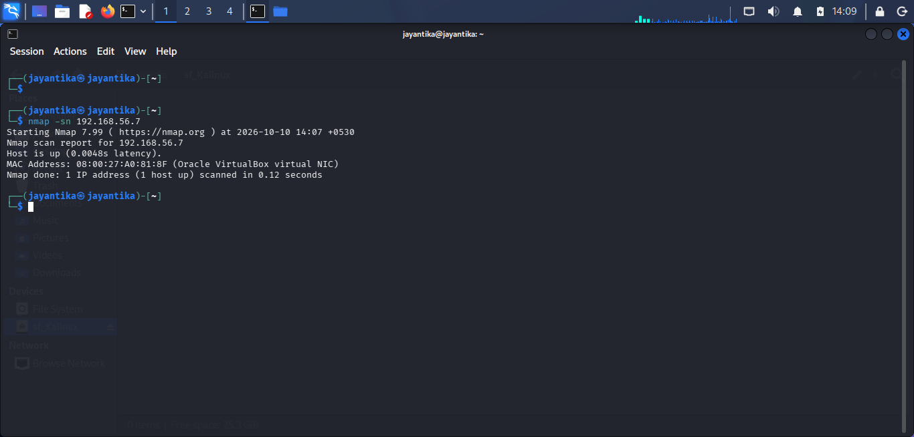

# Reconnaissance

## Objective

It collects initial information about the target system and verify its presence on the lab network before performing detailed scanning.

## Lab Environment
1. Virtual Box: `Oracle Virtual Box`
2. Host/Attacker System: `Kali Linux`
3. Target System: `MetaSploitable2`
4. Network Configuration: `Host-Only Adapter`
5. Tools: `Nmap`

## Host Discovery

```nmap -sn 192.168.56.7```

### Explaination

The command is executed by Kali Linux against the target. The *-sn* performs host discovery without conducting a port scan.

### Observed Results

- Target IP: 192.168.56.7
- Host status: Up

<br>

## Conclusion

This phase was used to identify and verify the target host against Metaspoitable2.