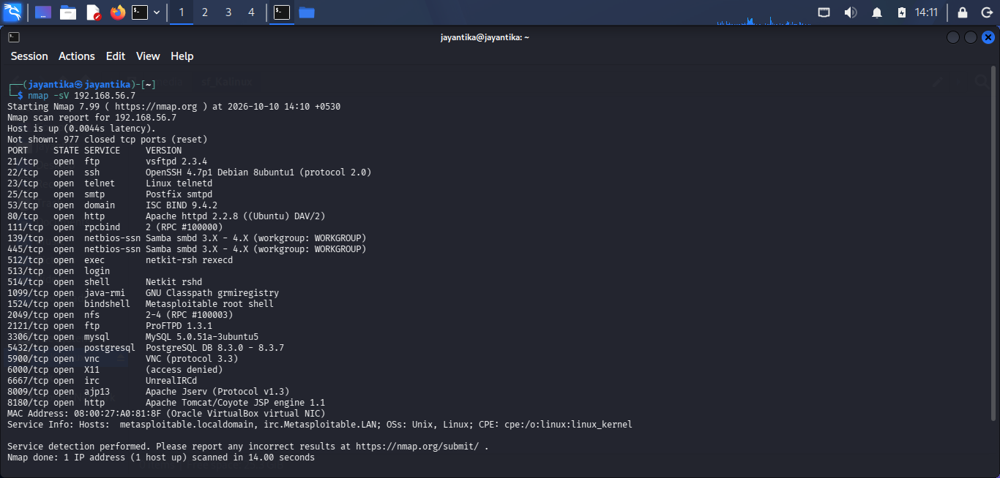
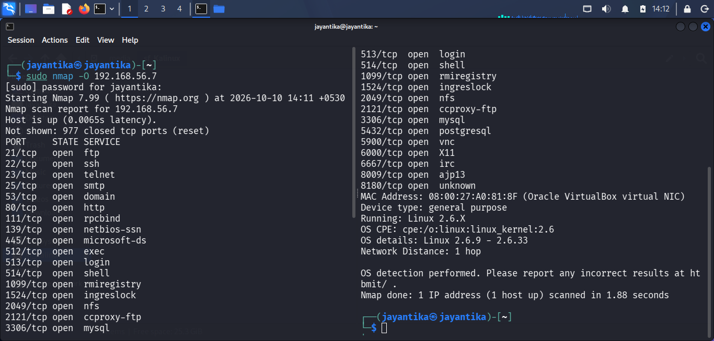

# Scanning and Enumeration

## Objective

The objective of this phase is to identify open ports, running services, service versions, and operating system information on target.

## Lab Environment
1. Virtual Box: `Oracle Virtual Box`
2. Host/Attacker System: `Kali Linux`
3. Target System: `MetaSploitable2`
4. Network Configuration: `Host-Only Adapter`
5. Tools: `Nmap`

## Service and Version Detection

### Command Used

```nmap -sV 192.168.56.7```

### Explaination

The Nmap service detection scan was performed against the target to identify accessible ports and the services associated with them.


### Results

<br>

## Operating System Detection

### Command Used

```sudo nmap -O 192.168.56.7```

### Explaination

The operating system detection was used to estimate the operating system of the target using network responses.

### Results

- Target IP: 192.168.56.7
- OS detection result:

<br>


## 6. Conclusion

The scanning and enumeration phase collected information about the target's accessible ports, running services, and possible operating system. These findings provide a basis for further vulnerability analysis and risk assessment.
