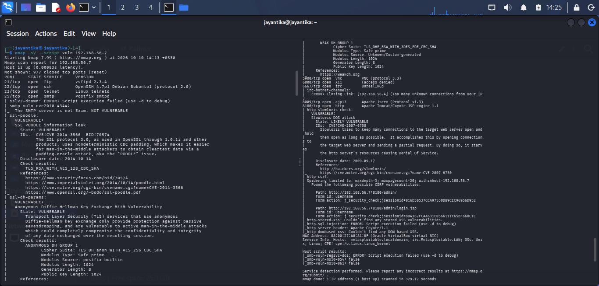
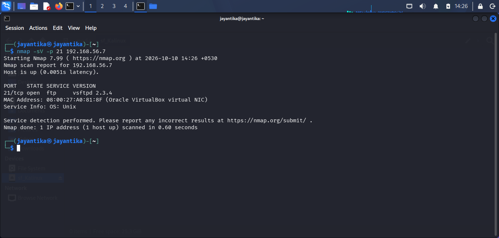
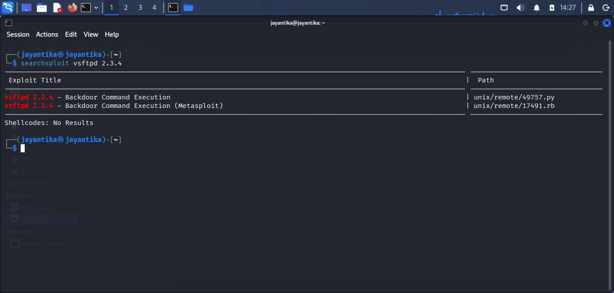
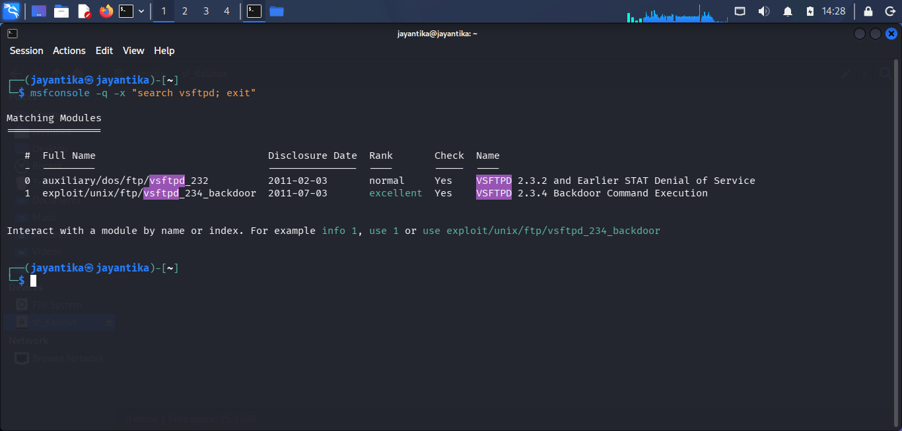

# Vulnerability Analysis

## Objective

It is to identify potential vulnerabilities in the target system by analyzing open ports, running services, service configurations, and their possible security risks, with a focus on identifying a service that can be exploited to gain a reverse shell and system access.

## Lab Environment

1. Virtual Box: `Oracle VirtualBox`
2. Host/Attacker System: `Kali Linux`
3. Target System: `Metasploitable2`
4. Target IP Address: `192.168.56.7`
5. Network Configuration: `Host-Only Adapter`
6. Tools: `Nmap, Metasploit (searchsploit/msfconsole)`

## Vulnerability Scanning

### Command Used

````nmap -sV --script vuln 192.168.56.7```

### Explanation

The Nmap vulnerability script scan was used to check the target for potential security weaknesses associated with detected services.

### Results

The vulnerability scan results should be recorded based on the actual terminal output.

<br>

## Service and Version Verification

### Command Used

```nmap -sV -p 21 192.168.56.7```

### Explanation

Nmap service/version detection was used to confirm the exact version of the FTP service running on the target, since outdated FTP daemons are known to carry serious vulnerabilities.

### Results

- Target IP: `192.168.56.7`
- Port: `21/TCP`
- State: `Open`
- Service Name: `ftp`
- Service Version: `vsftpd 2.3.4`

<br>

## Known Vulnerability Research

### Command Used

```bash
searchsploit vsftpd 2.3.4
```

### Explanation

The identified service version was cross-referenced against known exploit databases to confirm the presence of a documented vulnerability.

### Results

The search confirmed that `vsftpd 2.3.4` contains a known backdoor vulnerability (CVE-2011-2523), in which a maliciously modified version of the software was distributed for a period of time, allowing unauthenticated remote command execution.

| CVE ID | Service | Description |
|---|---|---|
| `CVE-2011-2523` | `vsftpd 2.3.4` | Backdoor allowing remote command execution via a crafted login string |

<br>

## Metasploit Module Verification

### Command Used

```msfconsole -q -x "search vsftpd; exit"```

### Explanation

Metasploit's module database was queried to confirm that a working exploit module exists for this vulnerability, which would be used in the Controlled Exploitation phase to establish a reverse shell.

### Results

- Module Identified: `exploit/unix/ftp/vsftpd_234_backdoor`
- Rank: `Excellent`

<br>

## Security Observations

1. TCP port 21 was found to be open on the target system, running `vsftpd 2.3.4`.
2. This version is publicly documented to contain a backdoor (CVE-2011-2523) that allows unauthenticated remote command execution.
3. This configuration presents a serious security risk because successful remote exploitation could provide an attacker with a reverse shell and root-level system access.

## Risk Assessment

| Finding                              | Potential Impact                         | Severity                  |
| ------------------------------------- | ----------------------------------------- | -------------------------- |
| Backdoored FTP service (vsftpd 2.3.4) on TCP port 21 | Potential unauthorized remote command execution and root-level access via reverse shell | Critical potential impact |

## Remediation

1. Upgrade `vsftpd` to a current, patched version not affected by CVE-2011-2523.
2. Verify the integrity of installed packages against official sources to rule out tampered binaries.
3. Restrict access to unnecessary ports using appropriate firewall rules.

## Conclusion

The vulnerability analysis identified a critical, publicly documented backdoor vulnerability in the `vsftpd 2.3.4` service running on TCP port 21 of the Metasploitable2 target.